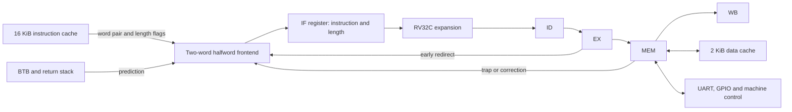

# RV32IMC implementation for the 153 MHz system

This is a qualified RV32IMC derivative of `accepted-153-valid-ram-v31-r1/accepted_valid_ram`. The current RTL passes the original 153 MHz internal timing constraints, functional regressions, both full CoreMark configurations and the resource-efficiency gate. Three cold-programmed hardware runs for each CoreMark seed configuration match the complete RTL output byte-for-byte. The accepted RV32IM source and its hardware evidence remain the reference.

Both full 6,000-iteration simulations pass on this exact RTL: V0 takes 1,782,669,419 cycles (514.958068 CoreMark at a configured 153 MHz), and V1 takes 1,784,414,808 cycles. The score exceeds the accepted reference by 0.6324%. The standard 115,200-baud physical images use 6,638 LUTs, 3,007 FFs, 21 DRM and four APM, with +0.158 ns setup slack and +0.100 ns minimum hold slack. A separate 9,600-baud profile for the remote serial gateway uses 6,640 LUTs and 3,015 FFs, with +0.090 ns setup slack; its CoreMark/LUT improves by 3.8302%. CPU RTL, firmware and configured CPU frequency are identical between these UART profiles.

The authoritative evidence table, UART profiles and qualification status are recorded in [QUALIFICATION.md](QUALIFICATION.md). [release.json](release.json) identifies the qualified images and evidence. The hardware-validated profile uses 9,600-baud UART; the 115,200-baud profile is locally qualified. The overall throughput improvement includes firmware-layout and supporting architecture changes; it is not an isolated C-extension speedup.

## Acceptance gates

The stricter, latest no-ILA reference is 511.722087538 CoreMark at 153 MHz, with 6,851 post-route LUTs, 3,331 flip-flops, 21 DRM blocks and four APM blocks. Its CoreMark/MHz is 3.344588807 and CoreMark/LUT is 0.0746930503. It passed internal timing with +0.053 ns setup slack under the existing 0.150 ns setup uncertainty.

The compressed derivative must pass instruction/system regressions, meet the original 153 MHz timing constraints, exceed the reference's full-duration CoreMark score, and achieve at least the reference's CoreMark/post-route-LUT ratio. Report flip-flops, DRM and APM separately; reduced LUT usage alone is not evidence of reduced total physical cost. Simulation-derived throughput is not a board measurement.

## Architecture

- Integer RV32C instructions expand into the existing RV32I execution datapath between the existing IF and ID registers. There is no extra execution pipeline stage. Instruction lengths accompany the early pipeline stages so sequential PCs and link addresses advance by two or four bytes.
- A halfword-aware frontend buffers two tagged words, assembles instructions crossing a word boundary, overlaps fetch response and subsequent request, and bypasses available cache responses. Buffered data takes precedence over an outstanding response whose data is not yet valid.
- Each returned word carries two instruction-length flags, one for each halfword. The cache classifies each bank/way before the late way-selection mux, and the frontend buffers these flags beside the data. This removes instruction-length classification after the wide data mux without adding a cycle or changing instruction availability. Assertions compare the flags with the instruction bits on cache responses and frontend consumption.
- The instruction cache optionally returns both words of an aligned eight-byte pair. Even/odd banks retain the original instruction-data capacity. The three tag bits share spare width in the even-word BRAM banks (35 bits per entry), removing a separate tag memory. Valid bits occupy banks of up to 128 entries in LUT RAM. Each bank's lookup registers at request acceptance, and a registered bank selector chooses the result; refill-valid forwarding handles a newly filled line. Read-only writeback metadata is omitted. The full system retains 21 DRM blocks in the packed-tag physical trial.
- The BTB indexes and records halfword addresses. Its LUT-RAM validity array clears over 256 clocks after reset/invalidation; predictions and training are suppressed while clearing. The current candidate retains 256 entries, four-bit local history, two-bit prediction counters and the return stack. Smaller tables and one-bit counters were rejected because their performance loss was excessive. All eight index rotations were screened with three-bit history; rotation four was retained, then four-bit history improved both benchmark seed configurations.
- Each BTB entry stores the direction selected by its current local history. Training computes the next history and the direction that the updated counter table will supply, including the case where the old and new history select the same counter. Allocation initializes this bit from the same weak-counter state used by the original predictor. Fetch therefore reads one direction bit instead of selecting a counter through the local-history mux. This preserves prediction behavior: a frozen original RTL model is compared over 1.4 million checks spanning seven history/counter/table/return-stack configurations, and the full SoC observer compares the stored bit with the original counter-table lookup on valid conditional predictions.
- Unconditional-taken prediction and return eligibility are folded into the BTB training writes. Fetch reads the final direction bit and an already-qualified return bit; it does not repeat the conditional-branch test. The frozen reference-predictor miter checks this transformation, including branch-type replacement and return-stack behavior.
- Predictor target data is computed independently of the prediction-hit qualifier; consumers select it only under `predicted_taken`. Removing the redundant hit-dependent target mux shortens the companion-buffer write-enable path and removes its unused fallback adder.
- EX computes sequential-target and branch-target prediction mismatches in parallel. MEM retains two mismatch bits and selects them with its existing taken bit, replacing a 32-bit prediction register and a late next-PC comparison. Writeback comparison precomputation uses `mem_value` directly: its results are consumed only when the corresponding writeback is valid. Simulation assertions check these transformations against the original comparisons at every relevant cycle.
- Writeback dependency matches are computed for the next EX/WB register pair before the edge. Source-zero masks are decoded in ID. FIFO nonempty flags update with their occupancy counters, including simultaneous push/pop; the UART interrupt/idle paths use these flags. These changes remove late status/operand decoding without adding an instruction stage or changing interrupt latency. Assertions compare the registered qualifiers with the original expressions, and the existing FIFO/UART/MMIO regressions are retained.
- MEM forwarding eligibility and WB destination-write eligibility are registered alongside their existing pipeline payloads. Validity still gates their use. Observers compare the registered flags with the original write-enable, destination-zero and exception predicates.
- Early branch predicates combine equality, unsigned comparison and operand signs directly with the branch type. The late predicate does not wait for a separately selected signed-comparison result. Six per-pair observers compare this factoring with the original relation selection.
- The multiply/divide unit exposes result availability independently of request acceptance and cancellation. EX combines that availability with its existing transfer and exception conditions; the actual result handshake still uses `rsp_valid`. This removes the path from a data-cache response through multiply request qualification and back into EX readiness. Observers compare every EX transfer with the original expression and reject multiply consumption without a valid response. Existing arithmetic and precomputation testbenches cover cancellation, held responses, signed/unsigned corner cases and availability before request assertion.
- EX operands load the ID candidates whenever EX can accept a replacement; otherwise they retain the forwarded values needed by a stalled instruction. Payload changes in an invalid slot have no architectural effect. An independent simulation monitor implements the original valid-gated operand updates and compares every valid EX operand. Writeback comparison precomputation uses the same next-operand values. This removes late clock-enable terms without adding a cycle; no power-saving claim is made for the broader loading condition.
- Writable-cache dirty bits use LUT RAM. Valid bits still reset immediately; allocation clears the dirty bit before making a line valid. Dirty contents of invalid lines need no reset. Writeback, byte strobes, eviction failure handling and flush behavior remain covered by the cache regression.
- Fetch request selection does not wait for instruction-length decoding. It conservatively waits for the following word before issuing a predicted-target request from an upper halfword, avoiding a straddled-instruction deadlock. The aligned companion address uses bit concatenation, and redirect range checks precede address selection. Refill forwarding compares registered refill/request indices rather than a live successor-request address.
- The outstanding-request address register may preload the selected address whenever its slot is empty or the previous response completes. Only the request handshake asserts pending validity. This removes late prediction and request-valid logic from the address-register enable while preserving every outstanding address; a simulation observer compares against a handshake-only reference register.
- Fetch acceptance uses the precomputed execution-transfer capacity when interrupts are absent. Redirect and invalidation already suppress frontend output, so their redundant readiness terms are removed. Companion-buffer replacement releases a consumed word on sequential word advancement; omitting a predicted-target address comparison can cause a later refetch but does not discard a needed halfword. Randomized backpressure tests check instruction assembly and bounded progress, and an observer checks acceptance against the original handshake expression.
- Companion replacement tests whether the current instruction is available and the pipeline has space, without waiting for redirect cancellation. If a redirect cancels that instruction, its old buffered payload is no longer required. The output handshake still honors redirects and invalidation. This removes the branch-resolution path from a wide buffer clock enable; both short CoreMark configurations retain their cycle counts after the change.
- `misa.C`, halfword-aligned `mepc`, compressed trap values, instruction-access faults in a straddled instruction, and FENCE.I invalidation are implemented. An out-of-range fetch faults instead of aliasing physical RAM.
- UART, GPIO, machine-mode traps/interrupts, counters, caches and multiply/divide remain present. The target is the user's no-ILA configuration.

## Development history and interpretation

The following entries are historical experiments, not the release qualification. Current source-bound evidence is listed in [QUALIFICATION.md](QUALIFICATION.md). All result paths are relative to `cpu_paper/results`. Each physical run has a frozen source snapshot, source hashes, timing reports and a manifest. Later source changes require fresh qualification.

| Experiment | Evidence | Result |
| --- | --- | --- |
| Exhaustive integer compressed decoder comparison | `rvc-oracle-20260930` | All 49,152 compressed encodings agree with the vendored Ibex RV32Zca decoder on legality and expansion. |
| Upstream RV32I/M/C and directed system tests | `rvc-isa-20260930T103952Z-55bcf6f6` | 49 programs pass on the paired-fetch predecessor. |
| Reserved encodings and access-fault boundaries | `rvc-isa-20260930T104440Z-4df408e9` | Compressed/system tests pass, including the second half of an instruction crossing the RAM limit. |
| Fast cache hits disabled | `rvc-isa-20260930T110041Z-90319ce2` | Pass after correcting premature selection of outstanding response data. |
| Short CoreMark V0/V1 | `rvc-coremark-20260930T110041Z-0f94e90e` | CRCs pass; 2,979,187 / 2,982,257 timed cycles for ten iterations. Too short for a reportable CoreMark score. |
| Full CoreMark, earlier single-word frontend | `rvc-coremark-20260930T101800Z-9ae96f99` | V0 completed at 1,801,174,728 cycles (509.667377 at a nominal 153 MHz). Its subsequent V1 run was deliberately stopped; the overall run is not complete. |
| Physical paired fetch, synchronous tags, IF-to-ID expansion | `rvc-physical-20260930T105127Z-5e3173a0` | 7,266 LUTs, 3,413 FFs, 22 DRM, four APM; setup WNS -1.545 ns. **Fails 153 MHz.** |

Full 6,000-iteration V0 and V1 simulations of a paired-fetch predecessor completed in `rvc-coremark-20260930T104840Z-8531232a` and `rvc-coremark-20260930T104840Z-de769f86`. V0 used 1,785,070,504 cycles; V1 used 1,786,458,696 cycles. CRCs and independently observed cycle/retirement counts match. At a **nominal** 153 MHz these correspond to 514.265402 and 513.865785 iterations/second, respectively. V0 is 0.497% above the accepted reference. These are simulation projections for a predecessor, not proof of a timing-qualified or board-validated release.

Subsequent request factoring and predictor-validity storage were qualified separately. That intermediate version's short V0/V1 runs use 2,979,985 / 2,983,136 cycles (`rvc-coremark-20260930T111009Z-2c0e722e`). The independent frontend runner passes exhaustive decoder comparison plus 480,000 randomized cycles at each of 16- and 32-bit address widths (`rvc-frontend-tests-20260930T111411Z-d352a2c5`). Random tests vary instruction bits, poison response data before response-valid, and check bounded progress as well as instruction assembly. Software, timer and UART interrupt return tests pass at halfword-aligned PCs (`rvc-isa-20260930T110551Z-122a6d5c`).

The standalone compressed firmware is linked at address zero. The historical accepted result used its qualified relocated loader image. Therefore, a score difference also contains code-layout effects; it must not be described as an isolated causal measurement of the C extension.

The current short same-layout RV32IM control (`rvc-coremark-20260930T153155Z-bf7aaa26`) takes 2,960,668 / 2,957,270 cycles for V0/V1, versus 2,975,495 / 2,978,961 for RV32IMC (`rvc-coremark-20260930T152849Z-0214ee3a`). Thus these controls do **not** establish a C-only execution-speed improvement. They use ten iterations and do not qualify as full-duration CoreMark results. Acceptance compares the complete implementation with the qualified historical baseline while reporting this limitation explicitly.

The instruction-length-metadata revision passes all 50 ISA/system programs (`results/rvc-isa-20260930T131622Z-3f387c66`), exhaustive decoder comparison and 960,000 aggregate randomized frontend cycles (`results/rvc-frontend-tests-20260930T131622Z-02d7a70a`), and all nine cache configurations (`results/rvc-cache-tests-20260930T131620Z-bbc863b4`). Directed compressed/system tests also pass with the cache disabled, registered cache responses, and prediction disabled in the three `rvc-isa-20260930T131715Z-*` runs.

## Reproduction entry points

`fpga/pds_soc_top.v` is the standalone 153 MHz RV32IMC wrapper. It explicitly enables M, C, caches, prediction and the accepted overlap/bypass settings. The generic board/core module defaults are not the release configuration. The physical runner binds the selected firmware into this wrapper and preserves an exact copy with the generated project.

Use `cpu_paper/scripts/run_rvc_coremark.py` for frozen-source short/full CoreMark simulations. Select `--iterations 6000 --configuration V0 --max-cycles 2400000000` for a duration-qualified V0 run, and repeat with V1. `--isa rv32im` is available as a control; preserve compiler/layout metadata when comparing.

Use `cpu_paper/scripts/run_rvc_isa.py --all` for the vendored upstream regression plus local compressed system cases. Optional `--predictor 0`, `--cache 0` and `--fast-hit 0` exercise alternate configurations.

Use `cpu_paper/scripts/run_rvc_frontend_tests.py` for the independent Ibex decoder oracle and randomized frontend tests. It freezes its inputs, including the reference decoder, before compiling.

Use native Windows Python with `cpu_paper/scripts/run_rvc_predictor_tests.py` to compare the precomputed direction against `sim/rv32_btb_reference.sv`. That fixture preserves the predictor before direction precomputation; it is a simulation reference and is not included in the FPGA build. The test covers simultaneous fetch/training, replacement, saturation, repeated histories, invalidation, reset, address bounds and return-stack activity. These finite simulation checks are not a formal equivalence proof.

Use native Windows Python with `cpu_paper/scripts/run_rvc_cache_tests.py` for the existing cache testbench adapted to check paired responses. It sweeps fast/registered response modes, overlap modes and full 16 KiB capacity, checks all returned words, exercises refill faults/backpressure/invalidation, and runs the writable-cache eviction/writeback regression. The original testbench is preserved in each result snapshot.

Use native Windows Python with `cpu_paper/scripts/run_rvc_physical.py --firmware <verified firmware.hex> --profile packing3_compact0 --seed 2`. It uses native Windows PDS, the existing board constraints and no ILA. The default UART rate is 115,200 baud; `--uart-baud 9600` produces the separately qualified remote-capture profile. `--profile` and `--seed` select only implementation profiles already defined by the project. A generated bitstream is not proof of timing closure.

The simulation/firmware scripts use the existing WSL toolchain. PDS does not run in WSL. Do not expose license values, change accepted baseline sources, or overwrite historical result snapshots.

`cpu_paper/scripts/assess_rvc_candidate.py --physical <run> --v0 <run> --v1 <run>` checks source hashes, hardware parameters, firmware identity, duration/CRC results, internal timing and resource gates together. It rejects mixing timing from one RTL revision with performance from another. Supply `--board <V0 capture> --board <V1 capture>` to require three cold-programmed hardware runs for each configuration and compare their raw counters, CRCs and profiles with full RTL simulation. Without these arguments, its result is local qualification only.

The serial interface is accelerated in RTL simulation using the established 3,200 Hz/100-baud simulation settings. The timed CoreMark interval uses independently observed CPU cycles and the stated 153 MHz conversion; UART interaction is outside that interval. Physical builds use 153 MHz and their explicitly recorded UART rate. `run_rvc_board.py` reads that rate from the frozen physical wrapper before opening the remote serial port.

## Internal fetch interface contract

The paired response, when asserted, supplies the word four bytes after an eight-byte-aligned requested word. It never accompanies an odd-word request. `i_rsp_is_c[0]` classifies bits 1:0 and `i_rsp_is_c[1]` classifies bits 17:16; each flag is true when those bits differ from `2'b11`. The companion flags have the same meaning for the companion word. The data and its flags share the response handshake and buffer-write conditions. There is one outstanding request, and response data is consumed only under a response handshake or from a valid tagged buffer. `redirect_in_range` must equal the address-range check of `redirect_pc`; the SoC simulation observer checks this factoring at every redirect. FENCE.I invalidates buffered instructions and suppresses use of an outstanding response.
