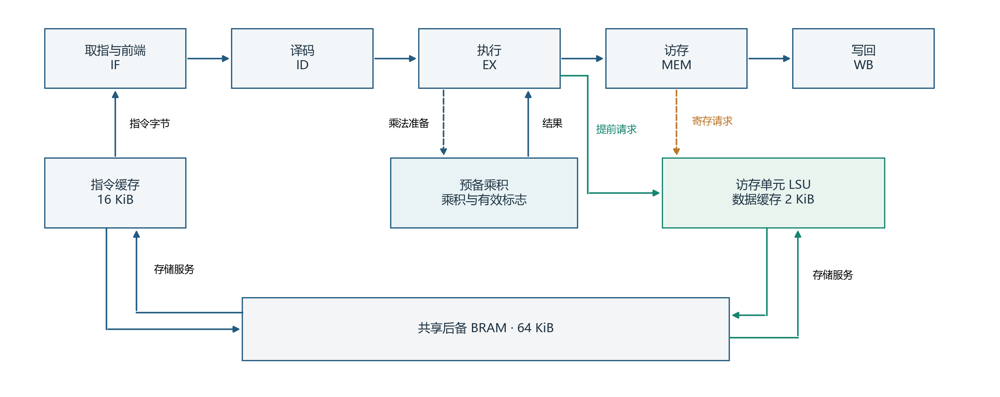
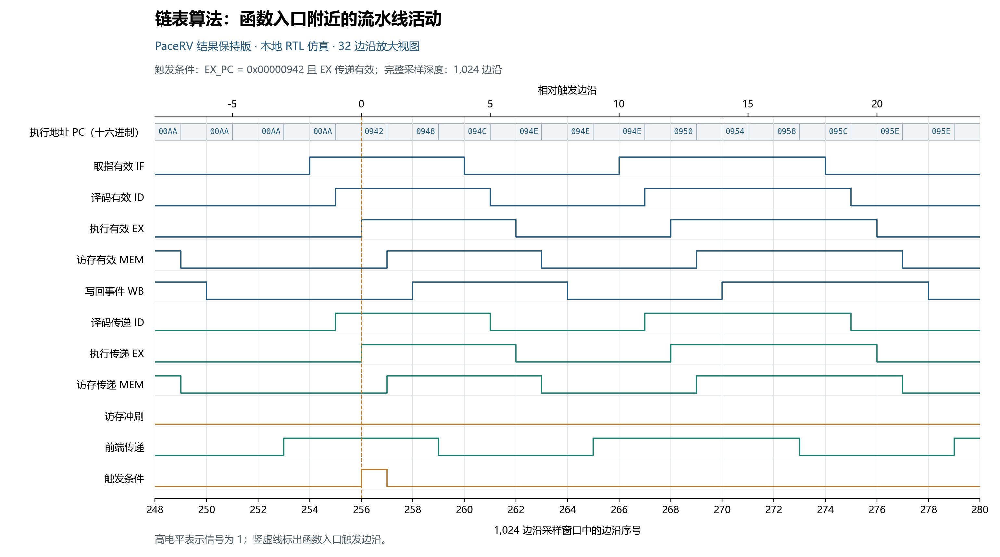
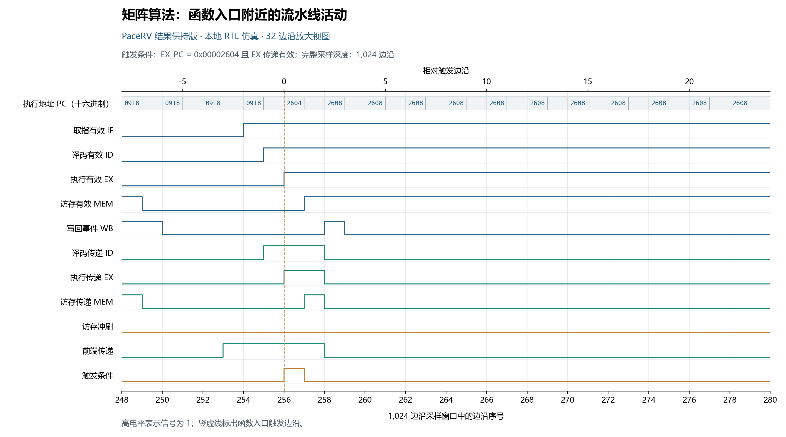
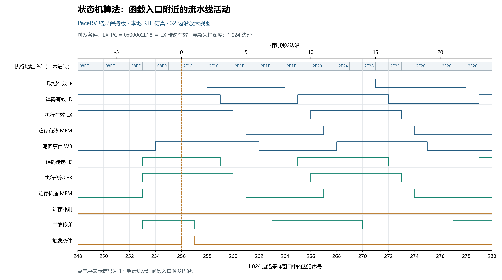

# PaceRV高性能RV32IMC处理器设计与实现

## 摘要

PaceRV是本团队自主设计的单发射五级顺序流水线RISC-V处理器，支持RV32IMC指令集，在紫光同创FPGA上实现了**3.442 CoreMark/MHz，达到单发射五级顺序RV32IMC FPGA软核的SOTA执行效率**。处理器在145.125 MHz下获得499.5 CoreMark，完整系统仅占用约6.1k LUT，同时保留指令与数据缓存、异常与中断、UART、GPIO、定时器和实时性能监测功能。

设计围绕指令供给、访存接纳和算术执行之间的协同展开。压缩指令前端与分支预测减少指令供给间隙，提前访存请求缩短等待，预备乘法结果保持机制复用已经完成的计算。19项Embench程序的对照实验表明，提前接纳数据请求使执行周期的几何平均值降低18.2%。团队进一步建立乘法结果有效期的选择方法，在152次有限窗口执行中准确预测额外快速消费次数。

相关研究成果已获第19届IEEE嵌入式多核／众核系统芯片国际研讨会MCSoC 2026录用。PaceRV处理器与论文复现材料均已开源，形成从RTL、固件、物理实现到板级运行记录的完整成果。[1–3]

## 第一部分 作品概述

### 1.1 功能与特性

PaceRV采用取指、译码、执行、访存、写回五级流水线，支持32位整数、乘除法和16位压缩指令。处理器集成动态分支预测、数据前递、相关冒险处理、机器态CSR及异常中断控制，并配置16 KiB指令缓存、2 KiB数据缓存和64 KiB共享后备存储器。UART、GPIO、64位定时器与动态性能计数器构成完整的软硬件运行平台。程序可通过串口输出运行结果、CoreMark得分和缓存统计，软件执行与硬件行为能够相互印证。

### 1.2 应用领域

PaceRV面向国产FPGA上的嵌入式控制、数据采集和软硬件协同计算。标准RV32IMC指令集便于使用现有C语言工具链；UART、GPIO和定时中断提供应用控制接口，性能监测模块支持程序调优。处理器可作为系统的通用控制核心，承担任务调度、外设管理和数据处理，也可与专用加速模块共同构成可编程计算平台。

### 1.3 主要技术特点

处理器通过压缩指令预处理、相邻指令供给和分支预测维持前端连续性；通过提前接纳数据请求，缩短执行级到存储系统的等待；通过绑定动态指令的预备乘法结果保持机制，在流水线停顿期间保存有效计算。双路组相联缓存与突发传输支撑指令和数据访问，完整外设与实时监测功能保留在高性能实现中。

### 1.4 主要性能指标

表1列出PaceRV两套板级实现。两者均在紫光同创PG2L200H-6FBB676上运行，资源数包含缓存、后备存储器、外设及动态监测模块。[2]

**表1 PaceRV完整系统的板级性能与资源**

| 指标 | PaceRV基础版 | PaceRV结果保持版 |
|---|---:|---:|
| 指令集与流水线 | RV32IMC，单发射五级顺序 | RV32IMC，单发射五级顺序 |
| 工作频率 | 145.125 MHz | 145.125 MHz |
| CoreMark/MHz | 3.441903 | **3.442075** |
| CoreMark | 499.506 | **499.531** |
| 查找表LUT／触发器FF | **6,097 / 2,541** | 6,150 / 2,541 |
| 存储块DRM／算术块APM | 25 / 4 | 25 / 4 |
| CoreMark/LUT | **0.081927** | 0.081225 |
| CoreMark/MHz/kLUT | **0.564524** | 0.559687 |
| 建立时间余量 | +0.047 ns | +0.016 ns |

基础版与结果保持版分别对应开源仓库中的Base和Retained配置。时序约束已计入0.150 ns时钟不确定性。DRM和APM分别采用PDS报告的原生存储块与算术块计数。

### 1.5 主要创新点

1. 将访存接纳、指令供给与预备乘法协同设计，在完整RV32IMC系统上实现3.442 CoreMark/MHz的SOTA执行效率。
2. 揭示访存接纳时机改变预备乘法结果的保持需求，建立有效期选择方法，并以逐指令对应和152次有限窗口执行验证。
3. 将高执行效率与约6.1k LUT完整系统、145.125 MHz运行及开源复现结合，形成可部署、可观察、可复用的处理器成果。

### 1.6 设计流程

团队从RV32IMC指令执行出发，完成流水线、缓存与外设集成，再通过固定程序的执行轨迹定位前端和访存等待。架构优化由模块仿真、完整程序仿真和物理实现逐级检验；最终以CoreMark校验、冷启动串口记录和时序报告确认实现结果，并将源码、固件与实验材料开源发布。

## 第二部分 系统组成及功能说明

### 2.1 处理器总体架构

PaceRV的设计目标是在紧凑的五级顺序流水线内充分利用每一个时钟周期。取指级提供指令，译码级完成操作识别和寄存器读取，执行级承担整数、分支及乘除法操作，访存级处理数据访问，写回级提交结果。指令按程序顺序发射和退休，流水线通过有效位和握手信号推进。

真正影响效率的是各级之间的衔接。前端遇到压缩指令边界、分支重定向或后端阻塞时，必须继续保持指令及其控制信息一致；执行级已经准备好的乘法结果，也需要在存储器等待结束后及时被使用。PaceRV将这些问题放到同一条指令执行路径上设计，减少供给间隙与重复计算。

指令缓存和数据缓存分离，分别服务前端与访存单元，通过仲裁共享后备BRAM。图1给出请求接纳与预备乘法的关键联系：数据请求的接纳时机改变后续指令停留在执行级的时间，进而改变预备结果需要保持多久。[1]

图1 PaceRV的访存接纳路径与预备乘法结构。提前请求缩短请求进入存储系统的等待，预备乘积保存已完成的算术工作。[1]

### 2.2 压缩指令前端与动态分支预测

RV32IMC程序同时包含16位和32位指令。前端需要处理半字对齐、跨取指边界的指令拼接，以及跳转后的重新定位。PaceRV将压缩指令预处理与缓存返回路径结合，保存相邻指令信息，减少重新访问指令存储器的等待。前端持续提供后续指令，执行级便能更充分地利用已有的运算能力。

控制流采用256项BTB，并结合方向预测、直接跳转目标计算与返回地址预测。预测信息随被接纳的指令进入流水线；发生停顿时，相关信息与指令一同保持。实际分支结果产生后更新预测状态，并在需要时重定向前端。这样，预测服务于连续的指令供给，重定向则恢复正确的程序路径。

数据相关通过前递和互锁处理。可从后级取得的结果直接送往使用者，尚未就绪的操作数则触发等待；加载使用、乘除法忙和下游背压均通过流水线握手协调。对应指令真正完成传递后，流水线才更新其归属状态。

### 2.3 提前访存接纳

同步BRAM系统中，一拍请求寄存会直接延长指令等待。PaceRV在EX向MEM传递时就向存储接口提供数据请求，使请求提前一个边沿被接纳。对于无争用的缓存命中，提前请求在边沿N接纳、N+1完成；寄存请求则在N+1接纳、N+2完成。响应服务本身保持相同，节省来自请求更早进入存储系统。

设计同时保留老请求优先、异常抑制和接纳记录。接口根据握手结果推进，在持续背压下保持请求内容，完成接纳后更新状态。较早的请求时机由此转化为程序可见的执行周期收益。

19项Embench程序使用固定RV32IMC二进制进行对照，提前请求使执行周期的几何平均值降低**18.2%**。[1,3] 这一结果说明，五级流水线的效率提升可以来自接口时序与指令推进的协同，而不必增加发射宽度。

### 2.4 预备乘法与结果保持

乘法指令进入EX、操作数已就绪且乘法器可用时，PaceRV提前形成低32位乘积。若下游能够推进，处理器使用该结果完成快速消费；若较早的访存尚未结束，Retained配置将乘积与当前动态指令一同保持，等待执行级释放。

结果保持的关键是归属。处理器记录预备结果对应的指令状态，在消费、指令离开、复位或相关取消事件发生时更新有效标志。新旧指令交接时，各自的有效状态按接纳顺序处理，保存的乘积能够服务于正确的指令。RV32M中的高位乘法、除法和取余由相应执行路径完成。

团队进一步发现，访存请求更早接纳后，需要额外保持的乘法机会从375,063次降至4,373次，减少**98.83%**。短等待的大量消失，使剩余机会中的长等待占比上升；在较慢读服务下，99%覆盖目标对应的有效期由18个边沿变为28个边沿。[1,3] 这项结果把“结果应保持多久”转化为可测量、可选择的设计参数。

有效期选择先依据执行剖面确定目标和规则，再通过相邻窗口执行验证。152次有限窗口执行的额外快速消费次数全部与预测一致，2,177,072组对应乘法的准备到消费间隔也被准确预测。新工作负载验证覆盖整数矩阵乘、快速排序、中值和向量加法，共58次执行。[1,3]

### 2.5 缓存与系统接口

PaceRV配置16 KiB指令缓存和2 KiB数据缓存，均为两路组相联、16字节缓存行，共享64 KiB后备BRAM。指令缓存支持前端指令供给，数据缓存处理读写及写回，突发传输完成缓存行填充。处理器与存储模块通过明确的请求、接纳、响应关系连接，缓存和后备存储的延迟由握手反馈到流水线。

机器态控制单元提供异常入口、中断处理、CSR访问和机器态返回。64位周期计数器与退休指令计数器为执行测量提供硬件基础，软件可通过CSR读取计数结果。UART收发与FIFO、8位GPIO、64位定时器及比较器构成系统外设，软件、定时器和外部中断接入处理器。

这些功能在表1的性能和资源结果中完整保留。实时监测模块统计指令／数据缓存命中与未命中、写回及体系结构计数器，能够将程序运行结果与硬件行为联系起来。

### 2.6 轻量化ILA观测设计

团队为PaceRV Base、Retained及155.25 MHz原始高频版分别构建了独立的最小ILA实现。观测聚焦执行级PC、五级有效状态和级间传递事件，采样深度为1,024个CPU时钟边沿。PaceRV采用24位数据观测与17位触发，使用函数入口PC和EX传递事件定位CoreMark关键算法。

观测信号围绕明确的问题选择：指令何时进入执行级，何时向后级推进，哪个阶段保持等待，以及写回何时持续发生。较少的探针即可呈现流水线的主要活动，同时控制调试逻辑的资源和布线开销。含ILA的三套完整系统均保持目标频率，物理实现结果见表3。

## 第三部分 完成情况及性能参数

### 3.1 SOTA执行效率与完整系统性能

PaceRV Retained完成6,000次CoreMark迭代，性能区间为1,743,134,699个时钟周期，在145.125 MHz下运行约12.011秒，达到**3.442075 CoreMark/MHz、499.531 CoreMark**。Base配置达到3.441903 CoreMark/MHz，完整系统使用6,097 LUT和2,541 FF。两套配置均保留缓存、外设、CSR和动态性能监测。[2]

PaceRV达到单发射五级顺序RV32IMC FPGA软核的**SOTA执行效率**。这一比较以已核实的公开实现为依据：表2给出论文中的VexRiscv配置与公开项目得分，并列明各项结果的测量来源。[2,3,5–7]

**表2 执行效率比较**

| 实现 | CoreMark/MHz | 数据来源 |
|---|---:|---|
| **PaceRV结果保持版** | **3.442075** | 完整SoC板级运行，6,000次迭代 |
| PaceRV基础版 | 3.441903 | 完整SoC板级运行，6,000次迭代 |
| VexRiscv，论文对比配置 | 2.742514 | 统一缓存容量及外设、监测和CSR范围的RTL测试 |
| rv32imc-pipelined-core | 2.88 | 五级RV32IMC公开项目报告值 |
| LEVEL | 2.62 | 五级RV32IMC公开项目RTL报告值 |

相对论文中的VexRiscv对比配置，PaceRV Retained的CoreMark/MHz提高**25.51%**。145.125 MHz的实际工作频率将高执行效率转化为约499.5 CoreMark吞吐，完整系统约6.1k LUT的占用则为上层应用保留了可观的FPGA资源。

### 3.2 资源效率与时序实现

PaceRV以紧凑的五级顺序结构实现性能目标。Base完整系统的资源效率为**0.081927 CoreMark/LUT**，按频率归一化为**0.564524 CoreMark/MHz/kLUT**；Retained分别为0.081225和0.559687。前者直接对应赛题的单位逻辑资源性能指标，后者便于同时考察执行效率与逻辑规模。

物理实现采用PDS 2022.2-SP6.4，工作点为145.125 MHz，时钟不确定性为0.150 ns。Base和Retained均通过全部10项已检查时序要求，建立时间余量分别为+0.047 ns与+0.016 ns。运算映射使用4个APM块，完整系统使用25个DRM块。

加入ILA后，PaceRV Base与Retained分别使用6,421和6,456 LUT，继续满足145.125 MHz约束。项目的原始高频版含ILA系统达到155.25 MHz时序闭合，使用6,609 LUT。表3给出各自的物理实现与完整程序仿真结果。

**表3 独立含ILA完整系统的实现结果**

| 含ILA系统 | 工作频率（MHz） | 查找表LUT／触发器FF | 存储块DRM／算术块APM | 完整仿真CoreMark/MHz |
|---|---:|---:|---:|---:|
| 原始高频版 | **155.250** | 6,609 / 3,573 | 22.5 / 4 | 3.365739 |
| PaceRV基础版 | 145.125 | **6,421 / 3,024** | 26 / 4 | 3.441903 |
| PaceRV结果保持版 | 145.125 | 6,456 / 3,024 | 26 / 4 | **3.442075** |

三套含ILA系统的完整6,000次迭代仿真均复现各自参考固件的UART字节、CRC、执行周期与退休指令数。0.150 ns时钟不确定性计入各自时序约束。

### 3.3 CoreMark关键算法流水线分析

CoreMark包含链表、矩阵和状态机三类代表性算法，分别呈现指针访存、密集整数运算和控制流处理的执行特征。本地RTL仿真按函数入口触发，为每种算法记录连续1,024个CPU边沿，并同步保存CSV、VCD及波形图。图2至图4展示PaceRV Retained的局部窗口。

图2 链表算法函数入口附近的32边沿RTL仿真放大图。表4统计对应的完整1,024边沿窗口。

链表窗口记录604次WB有效事件，执行级保持159个边沿、访存级保持158个边沿。图中的有效位与传递事件共同显示：流水线保存等待中的指令，在具备推进条件后继续向后级传递。对指针型程序，访存请求时机是优化等待的重要切入点。

图3 矩阵算法函数入口附近的32边沿RTL仿真放大图。

矩阵窗口记录675次WB有效事件，比链表窗口多71次；执行级保持117个边沿。其较密集的连续传递展示了整数计算路径的利用情况。预备乘法与流水线握手在同一执行路径中工作，已准备的结果随对应指令推进至后级。

图4 状态机算法函数入口附近的32边沿RTL仿真放大图。

状态机窗口记录674次WB有效事件，执行级保持96个边沿。该窗口将PC变化、流水线有效状态和级间传递放在同一时间轴上，直观呈现控制流变化与指令推进的关系。表4汇总三个完整采样窗口的统计量。

**表4 PaceRV Retained的1,024边沿局部RTL仿真窗口**

| CoreMark算法 | 写回有效事件 | 写回事件／采样边沿 | 译码保持边沿 | 执行保持边沿 | 访存保持边沿 |
|---|---:|---:|---:|---:|---:|
| 链表 | 604 | 0.589844 | 163 | 159 | 158 |
| 矩阵 | 675 | 0.659180 | 123 | 117 | 117 |
| 状态机 | 674 | 0.658203 | 106 | 96 | 94 |

局部窗口揭示算法内部的推进节奏，完整程序的CoreMark得分则由6,000次迭代的性能区间计数计算。两种观察尺度共同连接了流水线活动与整体执行效率。

### 3.4 板级运行与结果验证

PaceRV Base和Retained均保存性能与验证两套CoreMark固件，每套固件进行三次冷启动运行，共形成12份完整板级串口记录。记录包含启动、运行、校验和结束信息；重复运行得到相应固件一致的执行周期、退休指令与校验结果。

性能固件采用GCC 10.2.0、RV32IMC／ILP32、O3优化、循环展开和2,000字节数据规模。6,000次迭代的性能区间超过10秒，满足赛题的持续运行要求。团队以固件、串口结果、硬件计数和物理构建相互对应的方式保留结果，使性能指标能够追溯至实际运行实现。[2,4]

### 3.5 MCSoC论文成果与开源发布

PaceRV已形成处理器实现、架构研究和公开复现三方面成果。相关论文《Memory Admission and Result-Retention Sizing in an RV32IMC FPGA Soft Processor》获**第19届IEEE MCSoC 2026录用**，系统研究访存接纳、预备结果保持及其有效期选择。[1]

处理器以**PaceRV**名称开源发布。硬件仓库提供RTL、缓存与外设、固件、上板构建输入、比特流、串口运行记录和时序报告；独立的MCSoC复现仓库提供实验数据、依赖预测代码、有限窗口RTL、论文图表及复现脚本。[2,3] 使用者既能部署完整处理器，也能从程序和数据重新计算研究结果。

开源地址：<https://github.com/BXSYGJ/PaceRV>

论文复现地址：<https://github.com/BXSYGJ/PaceRV-MCSoC2026>

## 第四部分 总结

### 4.1 可扩展之处

PaceRV将标准RV32IMC执行环境、完整外设和性能监测组合成可复用的控制核心。后续可围绕实际应用连接图像、信号处理或AI加速模块，由CPU承担控制、配置与结果管理；现有级间事件和计数器也可用于分析应用中的访存热点、控制流及运算利用情况，指导软硬件协同优化。

### 4.2 设计总结

PaceRV的核心成果是在五级顺序结构中实现高效执行。团队将前端供给、访存请求接纳和预备乘法作为相互关联的路径进行优化，在国产FPGA上取得3.442 CoreMark/MHz、145.125 MHz及约6.1k LUT完整系统的组合结果。

性能提升落实在具体指令如何推进。数据请求提前一个边沿进入存储接口，程序就少等待一个边沿；已经准备好的乘积在停顿期间得到保持，计算工作就能继续被使用。逐指令实验进一步把这些局部行为与程序性能联系起来，形成了MCSoC论文成果。

处理器、物理实现、板级记录与实验材料的开源，使PaceRV同时具备性能展示和后续开发价值。它既是能够独立运行程序的完整软核系统，也是可供应用扩展与架构研究的FPGA计算基础。

## 第五部分 参考文献

[1] Dai Y, Xu S, Zhou Y, Peng C. Memory Admission and Result-Retention Sizing in an RV32IMC FPGA Soft Processor. 19th IEEE International Symposium on Embedded Multicore/Many-core Systems-on-Chip, MCSoC 2026，已录用.

[2] PaceRV. RV32IMC FPGA处理器开源实现与板级性能资料. <https://github.com/BXSYGJ/PaceRV>.

[3] PaceRV MCSoC 2026 Reproducibility Artifact. 论文实验数据、代码与复现材料. <https://github.com/BXSYGJ/PaceRV-MCSoC2026>.

[4] EEMBC. CoreMark Benchmark. <https://github.com/eembc/coremark>.

[5] SpinalHDL. VexRiscv. 论文对比版本680756065e9e6fc50d8c3d6c58191a16e867d822. <https://github.com/SpinalHDL/VexRiscv>.

[6] rkottomt. rv32imc-pipelined-core. <https://github.com/rkottomt/rv32imc-pipelined-core>.

[7] kerimturak. LEVEL RISC-V Processor. <https://github.com/kerimturak/level-v>.
