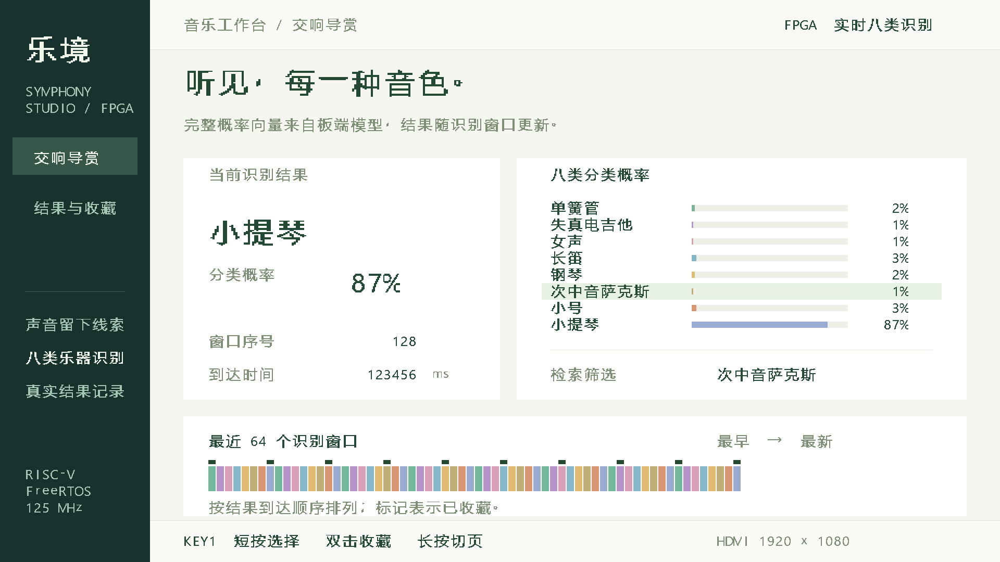
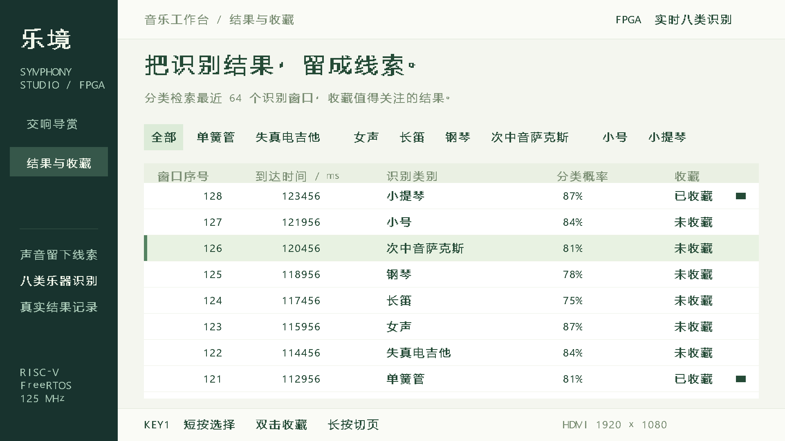

# 乐境：FPGA 交响乐导赏与识别窗口检索终端

正式终端通过 FPGA 的 HDMI 直接连接显示器，使用板载 KEY1 操作。`fpga/` 提供原生 1920×1080 渲染、中文 ROM、历史窗口控制器和整机集成入口；电脑仅用于构建、下载及开发检查。

本次原生整机位流已生成，下载与完整启动包见 [`symphony-hdmi-20261115`](../../releases/symphony-hdmi-20261115/README.md)。新位流为 3,791,112 字节，SHA256 为 `59a0e54a229681934f55ef3bfef45cac4fa96ddac3fecef4421bddd673bf5ee8`。整机编译、综合、映射、布局布线、时序报告和位流生成均已完成，退出状态 0；物理板卡显示与按键实测待接板验收。

## 两页板端应用

| 页面 | 画面与操作 |
|---|---|
| 可视化导赏 | 当前识别乐器、八类模型概率、最近 64 个识别结果及类别筛选。短按切换“全部 / 八类乐器”，双击标记最近一次结果，长按进入检索页。 |
| 窗口检索与标记 | 沿用导赏页的类别筛选，按由新到旧的顺序查看真实结果、窗口序号、到达时间、获胜类概率和书签。短按选择下一条匹配结果，双击切换该条书签，长按返回导赏页。 |

KEY1 是低有效的 C23 引脚。手势参数为 20 ms 消抖、300 ms 双击判定窗口、900 ms 长按。单击在双击判定结束后执行；长按保持期间只切页一次。导赏页双击重复标记同一条记录时保留书签。底部常驻操作提示，两页共用同一份板端历史。

屏幕使用暖白背景、深绿导航区和不同类别的柔和强调色，中文正文按 32 像素字格排版，大结果使用 64 像素字格。显示由坐标绘制与同步 ROM 读取完成，视频信号统一延迟五个像素时钟。

以下是实际 RTL 输出的完整画面，数据来自明确的仿真测试向量：





## 数据与当前硬件的对应关系

本版本以冻结的 125 MHz FreeRTOS 整机为基础，保留原音频采集、Mel、八类 NPU、共享 DDR 和处理器任务。HDMI 像素时钟为 148.5 MHz，模型顺序为：

1. 单簧管
2. 失真电吉他
3. 女声
4. 长笛
5. 钢琴
6. 次中音萨克斯
7. 小号
8. 小提琴

原 `bars_data` 通过请求/应答跨时钟传递完整八类快照，在帧边界同时更新八个百分比与类别。本应用仅在独立构建副本中增加单拍 `frame_update`，每次真实提交产生一次历史事件；相同类别的连续结果分别保留。控制器在像素域接收事件，通过四项队列在帧边界提交到 64 槽环形历史。读取按一拍同步协议完成，选中条目的类别、概率、时间、序号和书签来自同一记录。

显示时间是开机后该识别结果到达的毫秒时间。记录指向本次识别窗口；当前窗口约 2.752 秒。历史与书签保存在 FPGA 易失状态中，复位后清空，超过 64 条时覆盖最早条目。本版检索对象是识别结果及其标记，音频采样缓冲仍按原整机策略循环使用。

本版采用八类单标签模型的概率语义。仓库中的五组多标签训练结果继续保留，迁移五组模型后可扩展为同时活跃的乐器组及其进入、退出事件。

## 现场使用顺序

1. 将显示器接到 FPGA 的 HDMI 输出，按原八类整机流程下载本应用位流并加载对应权重。现有权重上传入口为 `scripts/weight_upload.py`，沿用 `scripts/outputs/weights_image.bin`。
2. 连接现有 PCM1808 模块与线路音源。冻结的 125 MHz 输入配置使用 PCM1808 提供的 48 kHz LRCK 与 3.072 MHz BCK，FPGA 的 BCK/LRCK 均为输入。
3. 页面先显示等待结果；收到完整八类结果后更新当前类别、概率条和历史。
4. 在导赏页短按到目标类别，屏幕显示“检索筛选”及当前类别；长按进入结果页，再短按浏览匹配窗口、双击标记。

接线细节见 [`PCM1808_AUDIO_INPUT.md`](../../docs/PCM1808_AUDIO_INPUT.md)，实际采样配置以该发布包冻结的顶层参数为准。权重、显示和音频使用同一八类整机版本。KEY1 在本应用中用于页面交互，原来的按键诊断导出已在独立顶层副本中移开。

交付 ZIP 的根目录提供 `START_HERE.md` 和 `LOAD_WEIGHTS.ps1`，配套 `runtime/` 内的权重与上传器。加载入口先核对权重大小、SHA256 和串口参数，再调用现有上传器；可加 `-DryRun` 检查文件和协议分帧。显式指定路径和真实解压布局下的默认路径均已执行通过。源码入口为 [`fpga/load_weights.ps1`](fpga/load_weights.ps1)。

## 重现原生终端

在仓库根目录使用 PowerShell 7。需要原生 Icarus Verilog、Python、Pillow、PDS 2022.2-SP6.4，以及既有 `rtos/` 构建依赖；全帧渲染检查使用项目已有的 Verilator 工作流。

```powershell
[Console]::OutputEncoding = [System.Text.Encoding]::UTF8
$ErrorActionPreference = 'Stop'
try {
    $project = [System.IO.Path]::Combine((Get-Location).Path, 'instrec_fpga')
    $native = [System.IO.Path]::Combine($project, 'apps', 'symphony', 'fpga')
    python -X utf8 ([System.IO.Path]::Combine($native, 'sim', 'run_state_test.py'))
    if ($LASTEXITCODE -ne 0) { throw 'KEY1/history simulation failed' }
    python -X utf8 ([System.IO.Path]::Combine($native, 'sim', 'run_commit.py'))
    if ($LASTEXITCODE -ne 0) { throw 'Coherent result/rollback simulation failed' }
    python -X utf8 ([System.IO.Path]::Combine($native, 'sim', 'run_integration.py'))
    if ($LASTEXITCODE -ne 0) { throw 'Real KEY1-to-HDMI integration failed' }
    python -X utf8 ([System.IO.Path]::Combine($native, 'run_render.py'))
    if ($LASTEXITCODE -ne 0) { throw 'Full HDMI raster verification failed' }
    python -X utf8 ([System.IO.Path]::Combine($project, 'scripts', 'check_rtl.py')) --src $native --exclude evidence
    if ($LASTEXITCODE -ne 0) { throw 'Native RTL style check failed' }
    python -X utf8 ([System.IO.Path]::Combine($native, 'build_system.py')) --stage prepare --label symphony-review
    if ($LASTEXITCODE -ne 0) { throw 'Native source preparation failed' }
} catch {
    Write-Error $_
    exit 1
}
```

`--stage prepare`只生成独立输入和配方；`--stage map`运行编译、综合、映射及真实处理器 ROM 审计；`--stage full`在相同输入上继续布局布线、时序报告与位流生成。整机沿用 125 MHz、seed 2、hold 8 配置。冻结的 `rtos/baseline125/` 保持原哈希，`APPLICATION.patch`记录副本内的顶层与事件脉冲接线，`INPUTS.json`记录整机输入及应用源、字体 ROM 的哈希；`PREPARED_RTOS_INPUTS.json`保留应用接入前的准备态清单。

每轮输出位于 `instrec_fpga/build/rtos/pds/`；以该轮 `INPUTS.json`、实际进程退出码和生成位流为完成依据。原始 125 MHz、109.375 MHz 及此前 RTOS 发布包继续使用各自完整输入，入口为 [`../../releases/RTOS_AND_BASELINES_20261114.md`](../../releases/RTOS_AND_BASELINES_20261114.md)。

## 已完成的原生功能检查

| 检查 | 实际结果 |
|---|---|
| KEY1 与历史控制 | 235 项检查通过，包括真实 winner 百分比、相同类别连续记录、四项队列、64 槽覆盖、筛选与手势去重。 |
| 实际按键到像素 | 9 项场景、23 个 RGB 采样和 145,035 项同步检查通过；真实状态查询、切页、选行、筛选高亮及标记添加、取消。 |
| 四幅完整画面 | 8,294,400 个可见像素、9,900,436 个视频时钟通过；RGB、DE、HS、VS 五拍对齐。 |
| 事件扩展及独立回退 | 原版、增加单拍事件、副本回退分别编译与运行通过；三次完整快照、同类连续两次、五个空闲帧的行为已核对。 |
| 实际 UI 存储初始化 | 字体 8,192 字、导赏与检索各 4,096 字逐字匹配；核对实际 8 个 DRM 的初始化和输出位连接。 |
| 原生整机实现 | 212 份输入冻结，原始 202 份基线哈希保持；完整 PDS 流程退出 0，生成本次新位流。最终 37,884 LUT、40,150 FF、1,431 distributed RAM、94 APM、130.5/155 DRM。 |

以上命令退出状态均为 0。具体输入 SHA256、实际命令和原始输出位于 [`fpga/evidence/`](fpga/evidence/)；帧截图使用仿真向量，实际按键联动检查使用真实状态模块及真实按键输入序列。

UI 存储审计覆盖 262,144 个逻辑位，其中 253,952 个实际存储载荷位逐位一致。两页图块各有一位全零调色板位被综合消除，报告单独列明；像素地址选择由全帧 RTL 检查覆盖。只读审计入口为 `fpga/audit_ui_rom.py --run <本轮PDS绝对路径>`。

固定 125 MHz / 148.5 MHz、seed 2 / hold 8 的最终时序已归档。系统 / 像素 slow setup 为 −1.921 / −0.591 ns，系统 slow / fast hold 为 −0.130 / −0.138 ns；保留用户选择的工作点和实际报告。资源与时序解析见 [`fpga/evidence/PDS_TIMING_AND_RESOURCES.json`](fpga/evidence/PDS_TIMING_AND_RESOURCES.json)，原始报告随 ZIP 的 `build/final_timing.rtr` 提供。

## 开发预览与离线数据工具

同目录的 `index.html`、`app.mjs`、`model.mjs` 和 `server.py` 是开发预览。它支持离线 JSON 轨迹、人工时间区间标注、关键词及组合条件查询、JSON/CSV 导出和本地音频区间预听。该预览运行在电脑浏览器中；FPGA 连接的显示器运行上述原生 HDMI 页面。

```powershell
[Console]::OutputEncoding = [System.Text.Encoding]::UTF8
$ErrorActionPreference = 'Stop'
try {
    $app = [System.IO.Path]::Combine((Get-Location).Path, 'instrec_fpga', 'apps', 'symphony')
    node --test ([System.IO.Path]::Combine($app, 'tests', 'model.test.mjs'))
    if ($LASTEXITCODE -ne 0) { throw 'Offline model tests failed' }
    python -X utf8 -m unittest discover -s $app -p test_server.py -v
    if ($LASTEXITCODE -ne 0) { throw 'Preview API tests failed' }
    & ([System.IO.Path]::Combine($app, 'run.ps1')) -Port 8765
    if ($LASTEXITCODE -ne 0) { throw 'Preview startup failed' }
} catch {
    Write-Error $_
    exit 1
}
```

启动器在后台返回 URL、PID 和日志路径，浏览器由使用者自行打开。内置演示轨迹标有演示来源；`/api/reference`读取仓库中的五组真实参考向量，各行是独立样本。串口观察保留 RTOS 原始八类记录，UART 的 `last_p`仅对应末通道。浏览器中的导出、音频关联和五组离线工具属于电脑开发功能。

## 文件入口

- `fpga/symphony_state.v`：按键手势、筛选、64 窗口历史与书签。
- `fpga/symphony_renderer.v`：1080p 两页原生渲染及同步视频流水。
- `fpga/gen_assets.py`、`fpga/assets/`：可重建中文字体和页面静态字图。
- `fpga/build_system.py`：冻结 RTOS125 输入上的应用副本集成。
- `fpga/sim/`：真实 RTL 仿真和事件扩展独立回退。
- `tests/`、`test_server.py`：开发预览的数据与浏览器检查。
