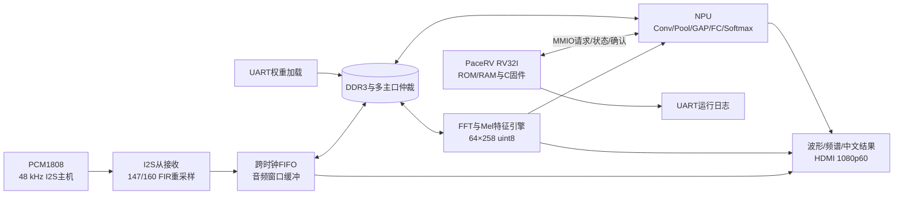
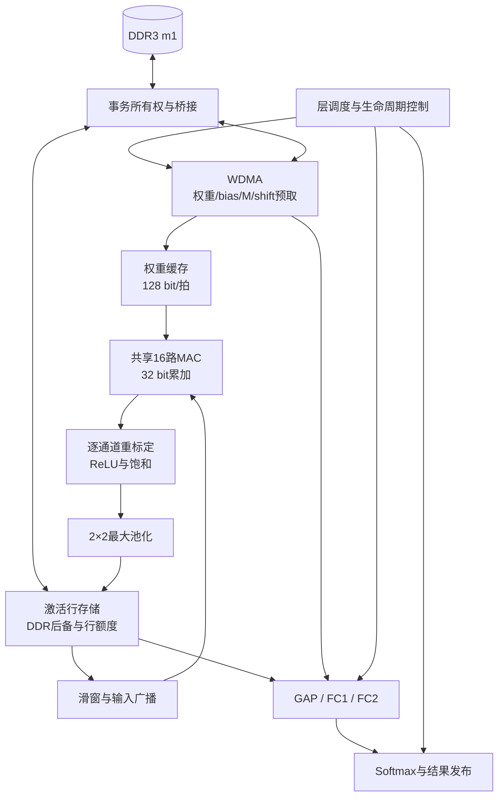

# PaceRV面向八类音乐音频识别的CPU与NPU协同系统

> PaceRV中文竞赛报告 · 应用部分 · 固定源码版 · 2026年11月3日
>
> 源码基准：`0c138d4f8590be1a0dde63e21d680e8d250e32a0`，当日17:23版本；原始全系统位流SHA-256：`1497faf47b83b64a62027c38b6bf94d12112002c250fc5278c3c28ad2fa46abe`。本文依据本分支的完整八类实现撰写，CPU微架构的详细论述由CPU报告承担。

## 摘要

本作品在盘古100Pro+开发板上实现面向音乐音频的本地识别系统，将PaceRV RISC-V控制核、音频特征提取硬件、INT8卷积神经网络加速器以及中文HDMI界面集成于PG2L100H FPGA。系统接收PCM1808输出的48 kHz立体声I2S音频，经147/160多相FIR转换为44.1 kHz，完成2048点FFT、64带Mel滤波、对数压缩、整窗标准化和量化，形成64×258的特征矩阵。NPU利用共享16路乘加阵列执行四层卷积、池化、全局平均池化和两层全连接，输出八类分类概率；CPU通过MMIO管理请求、状态、结果确认和运行记录。界面同步显示输入波形、Mel频谱、中文类别和置信度。

网络使用Medley-solos-DB官方划分训练与评估，包含685,864个可训练参数。独立测试集上FP32准确率为77.84%、macro-F1为70.67%；静态INT8量化后准确率为77.37%、macro-F1为69.55%，部署权重镜像为691,040字节。真实CPU固件与NPU的两轮连续仿真在不复位、输入完全变化的条件下通过逐层整数参考对拍，每轮NPU计算31,141,255周期。原始全系统位流完成启动、DDR3自检、权重加载和连续推理回读；30秒记录包含10次完成。本文分别报告模型评估、仿真周期和板级运行结果，并给出完整资源及静态时序数据，形成可追溯的应用技术说明。

**关键词：** PaceRV；RISC-V；FPGA；音乐音频识别；INT8量化；专用神经网络加速器

## 第一部分 作品概述

### 1.1 功能与特性

作品完成音频输入、采样率转换、时频特征计算、八类CNN推理、CPU控制及中文可视化链路。分类编号固定为0单簧管、1失真电吉他、2女声、3长笛、4钢琴、5次中音萨克斯、6小号、7小提琴。女声沿用数据集类别定义，因此“八类乐器识别”在本文中包含一个人声类别。输出是一个窗口的单标签分类及八类softmax分数，适用于独奏或单一主导音色片段。

### 1.2 应用领域

系统面向音乐教学、音色识别展示和嵌入式人工智能实验。使用者可以在同一画面中观察原始波形、Mel时频分布及分类结果，理解信号从采集到识别的处理过程。全部运行计算由FPGA及片上CPU完成，PC承担训练、构建及串口装载权重。系统也提供了国产FPGA上通用指令控制、定点DSP和神经网络计算协同设计的教学实例。多乐器同时存在时，softmax分数不具有音源分离结果或各乐器声能比例的含义。

### 1.3 主要技术特点

计算与控制分工明确：PaceRV执行C固件，专用逻辑处理FFT、Mel与CNN。共享16路MAC在四个卷积层间复用，DDR3承载权重和中间激活，片上缓存承担滑窗和局部复用。训练侧、离线量化及硬件侧以同一份层契约约定张量尺寸、量化零点、逐通道重标定和舍入规则。显示侧采用完整页与结果快照，连接计算时钟域和视频时钟域。

### 1.4 主要性能指标

| 指标 | 固定版本结果 |
|---|---|
| FPGA与开发板 | PG2L100H-6IFBG676，盘古100Pro+ |
| 音频输入／模型采样率 | PCM1808主机48 kHz／模型44.1 kHz |
| 特征与视频 | 64×258 uint8；1920×1080、60 Hz设计时序 |
| FP32／INT8测试准确率 | 77.8359%／77.3701%，12,236个测试样本 |
| FP32／INT8 macro-F1 | 70.6717%／69.5513% |
| NPU连续仿真周期 | 31,141,255周期，125 MHz折算249.130 ms |
| 原始位流板级记录 | 30秒10次推理完成，NPU约258.9 ms/次 |
| 全系统资源 | 33,967 LUT，35,466 FF，150.5 DRM，92 APM |

模型测试准确率来源于PC端离线评估。NPU计算时间不包含约3秒的音频采集窗口，也不等同于用户感知端到端延迟。资源与板级记录均对应固定的真实CPU＋NPU系统。

### 1.5 主要创新点

作品将CPU控制、音频定点流水、共享CNN阵列和中文显示连接成完整应用；以逐层数值契约约束从PyTorch到RTL的转换；针对DDR3读通道不可反压的接口，设计事务所有权、行缓存和消费额度机制，支持连续窗口切换；通过整页特征与结果快照保持识别结果和显示内容的一致性。

### 1.6 设计流程

先确定数据集、特征和网络，再进行训练、静态量化及权重打包；建立整数参考后设计音频、Mel、NPU、固件与显示模块。模块验证和连续窗口对拍确定数值行为，PDS编译及实现给出资源与时序结果，板级串口与实屏观察确认系统运行。本文统一以2026年11月3日下午完整实现为功能范围。

## 第二部分 系统组成及功能说明

### 2.1 系统总体架构



系统顶层为[`instrec_top.v`](../src/ctrl/instrec_top.v)。PCM接收与重采样工作在27 MHz域，DDR3用户侧及主要计算工作在125 MHz域，视频像素时钟为148.5 MHz。音频FIFO、特征页和显示快照分别处理跨域数据传递。DDR3接口封装控制器的读前dummy-write等要求，多主口结构连接音频、NPU、Mel和自检通路。

### 2.2 音频采集与时频特征

PCM1808作为I2S主机输出LRCK、BCK和DATA，FPGA为从接收端。输入LRCK为48 kHz，BCK为3.072 MHz，每个声道32位时隙承载24位有效数据，识别路径取高16位。紫卡J2的11、12、20针分别连接FPGA U20、T20、V16，并连接公共地。该版不要求FPGA向PCM1808提供外部MCK。

[`pcm1808_resampler.v`](../src/audio/pcm1808_resampler.v)实现147/160有理重采样，96抽头、147相系数采用Q1.15表示，最终使用round-half-even及s16饱和。左右声道均有历史缓冲，系数ROM利用对称关系压缩为7,104个基础项和73个修正项。音频进入跨时钟FIFO，再按完整窗口写入DDR3；默认左声道进入识别。

| 特征环节 | 固定参数与处理 |
|---|---|
| 音频 | 44,100 Hz，单声道，硬件窗口132,096点，约2.995秒 |
| STFT | 2048点FFT，Hann窗，hop=512，功率谱 |
| Mel | 64带，0至22,050 Hz |
| 对数压缩 | 按窗口最大功率归一，动态范围80 dB |
| 形状 | 64×258，共16,512个元素 |
| 标准化 | 整张频谱均值／标准差，训练侧epsilon=1e-6 |
| 输入量化 | uint8，scale=0.06266622245311737，zero_point=49 |

[`mel_engine.v`](../src/mel/mel_engine.v)协调FFT、Mel累加、dB归一及标准化流水。训练音频典型长度为131,072点，约2.972秒；librosa居中STFT通常产生257帧，再补齐至258帧，超长时保留末端帧。硬件窗口、边界扩展和定点流水有独立实现，因此张量形状一致不能单独证明真实输入分布完全一致。本文的离线准确率对应训练侧特征；硬件算术通过专用整数参考验证。

### 2.3 模型结构与设计理由

模型定义见[`training/src/model.py`](../training/src/model.py)。网络由四个Conv-BN-ReLU-MaxPool模块及两层全连接组成，无残差分支。3×3卷积均stride=1、padding=1，2×2最大池化stride=2。

| 层 | 卷积／FC权重尺寸 | 输出尺寸（不含batch） | 池化后尺寸 |
|---|---|---|---|
| 输入 | — | 1×64×258 | — |
| Conv1 | 48×1×3×3 | 48×64×258 | 48×32×129 |
| Conv2 | 96×48×3×3 | 96×32×129 | 96×16×64 |
| Conv3 | 192×96×3×3 | 192×16×64 | 192×8×32 |
| Conv4 | 256×192×3×3 | 256×8×32 | 256×4×16 |
| GAP | 每通道64元素平均 | 256 | — |
| FC1＋ReLU | 128×256 | 128 | — |
| FC2 | 8×128 | 8 logits | — |
| Softmax | 固定点归一 | 8类概率 | — |

训练时FC1后使用dropout=0.3；推理时关闭dropout，BN折叠至卷积。GAP将每通道4×16特征压缩为一个数，使全连接权重仅33,792个，避免直接展开大特征图。四层卷积权重共650,160个，纯权重合计683,952个。含偏置和BN可训练量共685,864个参数；BN运行统计属于状态，不计入可训练参数。

### 2.4 数据集与模型训练

训练使用Medley-solos-DB，共21,571个带标签片段；官方training/validation/test分别为5,841／3,494／12,236个样本。元数据包含`instrument_id`、`track_id`与`uuid4`，读取程序检查不同subset的track_id不重叠，避免同一音轨的相邻片段泄漏到测试集。测试集只用于最终评估，验证集用于选择检查点。

训练处理先加载音频并转换至44.1 kHz单声道，再提取固定Mel特征，可预计算为缓存以降低每轮开销。网络从随机初始化学习分类映射，训练程序提供按类别逆频率加权采样和加权交叉熵，用于处理钢琴、长笛与次中音萨克斯等类别的样本不均衡。优化器为Adam，初始学习率0.001、weight_decay=0.0001、betas=(0.9,0.999)、epsilon=1e-8；余弦调度T_max=50、eta_min=1e-5。每轮执行训练与验证，以验证准确率最高者保存检查点。

本分支保存实际部署来源[`best_model.pt`](../training/runs/best_model.pt)。其记录epoch=6、验证准确率93.961076%、验证loss=0.2486203；保存的调度器last_epoch=6、学习率0.00096523936，与上述优化器／调度参数一致。epoch字段表示最佳检查点位置，不能据此认定训练总共只运行六轮。

原项目后续实验覆盖了`train_config.json`和训练日志，后续FocalLoss／SpecAugment实验的记录不属于这个检查点。历史代码和开发记录支持基线采用加权交叉熵的训练流程，但已保存检查点不含采样、增强、batch size和随机种子的完整配置，无法从检查点独立恢复这些开关。为此，随附训练代码提供显式的加权交叉熵、关闭增强复现命令；batch=64、seed=42和早停参数作为可重新运行的配置记录，不能承诺重新训练逐字节得到既有权重。已有准确率直接绑定保存的模型和评估JSON。

训练工程环境记录为Python 3.12、PyTorch 2.3.1＋CUDA 12.1、GTX 1050 Ti 4 GB。该Pascal显卡的训练实现会关闭不适用的AMP路径。完整复现步骤、数据目录和命令见[`training/README.md`](../training/README.md)。

### 2.5 INT8量化与部署契约

采用训练后静态量化，使用训练集500个校准样本统计激活范围。离线工具使用fbgemm，四组Conv-BN-ReLU与FC1-ReLU融合后，卷积和全连接权重为逐输出通道对称INT8，激活为逐张量仿射uint8。权重的signed int8与激活的unsigned uint8必须分别解释。

卷积每个输出通道的整数计算为：

```text
acc[c] = bias_int32[c] + sum((x_q - zp_in) * w_int8[c])
y_q[c] = clamp_u8(round_half_even(acc[c] * M[c] / 2^shift[c]) + zp_out)
```

ReLU在对应层量化零点处截断，最大池化保留量化尺度。倍率由输入scale、逐通道权重scale和输出scale确定，采用逐通道M与shift存储。实际shift范围37至53，传输字段与运算必须完整保留，不能截为5位。Conv1的padding值为49，FC2输出零点为57；GAP的64元素平均也采用同型舍入。整数位级依据是[`layer_contract.json`](../scripts/outputs/layer_contract.json)及[`golden_pipeline.py`](../scripts/golden_pipeline.py)。

原导出的部分`bias_int32.npy`是将浮点偏置直接截断生成的中间文件，不能直接作为硬件偏置。随附[`gen_weight_image.py`](../scripts/gen_weight_image.py)使用TorchScript及数值探针重建偏置，并核对权重、激活参数和输出。权重按16输出通道组交错，每组内部按输入通道与卷积tap顺序排列，连续16字节正好对应一次MAC阵列取数。

部署镜像以IRW1头、层表和32字节对齐的权重／bias／M／shift段组成，共691,040字节，通过UART写入DDR3的0x00100000起始区域。固定镜像SHA-256为`19a74dbec29d3a0f16ab06dc30f70312849977de0c6b345710b046b1908f5d7a`。软件量化模型、FPGA镜像和量化契约均在本分支保存。

### 2.6 NPU计算架构



#### 2.6.1 层调度与计算复用

[`npu_top.v`](../src/npu/npu_top.v)协调Conv1→Pool1→Conv2→Pool2→Conv3→Pool3→Conv4→Pool4→GAP→FC1→FC2→Softmax共12个计算阶段。各阶段在数据提交及事务释放后交接，完成信号与行缓存状态一起管理，使下一窗口无需依赖全系统复位。四个卷积层使用同一套[`conv_engine.v`](../src/npu/conv_engine.v)，由输入尺寸、通道数、组数和量化参数改变其行为。

#### 2.6.2 16路MAC与滑窗

每个计算拍将一个输入值广播到16路MAC，同时读取128 bit权重，即16个有符号8位权重。激活减零点后的有效值用有符号9位表示，各路使用32位累加器。内层遍历输入通道和3×3 tap，外层遍历输出位置及16通道组。输入滑窗与行缓存复用相邻像素，避免每个乘法都访问DDR3。累加完成后，以64位乘积执行逐通道重标定，再舍入、加零点及饱和。

四层卷积合计461,445,120 MAC，FC另有33,792 MAC。125 MHz下16路卷积阵列的理想峰值为2.0 GMAC/s，按乘与加各算一次为4.0 GOPS；这只是阵列峰值。31,141,255周期记录折算的卷积有效速率约1.852 GMAC/s，包含该次NPU执行中的搬运、池化及分类阶段，不据此推导整机持续音频吞吐或功耗能效。

#### 2.6.3 权重与激活存储

[`wdma.v`](../src/npu/wdma.v)分组读取卷积权重，bias、M和shift分别装载，FC同样使用三类参数流。片上缓存服务当前计算组，DDR3保存全模型及较大的中间张量；激活行存储按读写生命周期交替使用，行额度防止生产方覆盖尚未消费的数据。寄存后的字节选择重放路径用于拆分读取／选择组合路径。

DDR3 IP不提供标准AXI的`rready`、`wvalid`和B响应接口。读事务发出后，接收端必须持续接住返回数据；写完成以`axi_wready`和最后beat计数联合判定。桥接与[`npu_m1_owner.v`](../src/npu/npu_m1_owner.v)将权重读取和激活读写的所有权保持到事务真正结束，不能仅凭请求撤销就切换消费者。此机制是共享内存和连续任务正确运行的基础。

#### 2.6.4 池化、GAP、全连接与Softmax

[`pool_engine.v`](../src/npu/pool_engine.v)对2×2窗口取最大值，压缩空间尺寸；GAP对每通道64个量化元素求和并以round-half-even除以64。FC引擎完成256→128→8两层矩阵向量计算，第一层附加ReLU。Softmax先减最大logit，利用固定点指数查表及归一化除法产生八类概率。内部Q0.16单类主导时可饱和至65535，显示99%由表示与整数显示规则决定，不意味着经过概率校准的99%识别正确率。

### 2.7 PaceRV控制与软件架构

本应用实例关闭M扩展和预测器，按RV32I编译C固件；程序ROM与数据RAM各8 KiB。源码保留CPU核所需依赖，实例参数决定实际启用功能。CPU执行启动、MMIO／ISA自检、推理请求、完成轮询、超时处理、结果读取和ACK，并打印周期日志。CNN、FFT和完整八类概率处理由专用硬件执行，CPU不承担这些密集运算。

| MMIO地址 | 用途 |
|---|---|
| 0x80000000 | 系统ID，预期0x52564331 |
| 0x80000004 | NPU busy/done/timeout、结果和DDR状态 |
| 0x80000008 | 最近概率事件与分类结果相关字段 |
| 0x8000000C／10 | UART发送／可发送状态 |
| 0x80000014 | LED控制 |
| 0x80000018／1C | cycle／instret计数低位 |
| 0x80000020 | DDR状态 |
| 0x80000024 | NPU请求与确认控制 |
| 0x80000028 | NPU周期数 |

控制循环为“提交请求→等待完整特征和启动条件→轮询busy／done→读取结果及周期→ACK→下一请求”。[`main.c`](../sw/rv32/main.c)使用volatile MMIO访问。概率事件寄存器保存最近事件，CPU没有从该寄存器顺序重建完整八元素向量；显示数据通路直接接收NPU概率流。固件启动与串口权重上传工具属于两个软件层次，上传程序在PC运行。

### 2.8 中文HDMI显示

界面在1920×1080视频时序下显示波形、Mel频谱、中文类别、八类概率条及状态。特征复制引擎将计算域的完整特征拷贝至显示页，显示端在页有效后切换；概率条数据和top1按完整结果发布，再通过快照／同步进入像素域。这样可以避免一个画面混用相邻推理窗口的类别与概率。字模ROM、坐标延迟及叠加逻辑共同保证字符、色块与视频同步信号对齐，相关源码位于[`src/ui/`](../src/ui/)。

## 第三部分 完成情况及性能测试

### 3.1 模型评估结果

| 评估对象 | 数据划分 | Accuracy | Macro-F1 | 说明 |
|---|---|---:|---:|---|
| FP32最佳检查点 | 验证集3,494 | 93.9611% | 见原始JSON | 检查点选择依据 |
| FP32最佳检查点 | 测试集12,236 | 77.8359% | 70.6717% | 独立离线测试 |
| INT8静态量化 | 同一测试集 | 77.3701% | 69.5513% | PC量化模型测试 |

量化使准确率下降0.4658个百分点、macro-F1下降1.1203个百分点。FP32测试weighted-F1为76.8157%。验证准确率明显高于测试准确率，测试集的类别分布和泛化难度应单独考察，不将93.96%写为最终测试准确率。

| 类别 | 测试样本数 | FP32 Recall | FP32 F1 |
|---|---:|---:|---:|
| 单簧管 | 732 | 67.21% | 57.81% |
| 失真电吉他 | 955 | 95.81% | 85.96% |
| 女声 | 1,142 | 99.21% | 80.07% |
| 长笛 | 3,167 | 53.90% | 65.38% |
| 钢琴 | 2,609 | 99.23% | 94.68% |
| 次中音萨克斯 | 325 | 16.92% | 22.27% |
| 小号 | 406 | 67.98% | 79.77% |
| 小提琴 | 2,900 | 81.28% | 79.44% |

按类别结果说明钢琴和失真电吉他较容易识别，次中音萨克斯是主要短板。仅报告总体accuracy会掩盖小样本类别表现，因此同时保留macro-F1及混淆矩阵。原始结果见[`evaluation_metrics_baseline.json`](evidence/evaluation_metrics_baseline.json)与[`quantization_config.json`](evidence/quantization_config.json)。原记录GTX 1050 Ti、batch=64的测试耗时约15.28秒，属于批量PC推理，不与FPGA单窗口延迟直接比较。

### 3.2 数值与连续任务验证

整数参考覆盖Mel流水和量化网络约定。真实CPU固件驱动NPU的两轮native连续测试中，16,512个特征字节全部改变，中间没有复位；两次请求、完成及ACK均符合预期，全部层输出与golden一致，每轮31,141,255周期。其意义是检查共享缓存、层生命周期与事务所有权在输入变化后仍正确，覆盖固定单输入测试难以发现的状态残留。证据见[`native_validation.json`](evidence/native_validation.json)。

上述native记录来自固定版本冻结前的验证环境，本分支保留记录和参考源码，不包含庞大的仿真生成目录。当前源码整理只改变目录和普通注释；56份RTL执行token与源版本一致，固件重建为2,320字节／580字且ROM一致。冻结包曾通过PDS compile，未在整理后重新执行布局布线或产生新位流。

### 3.3 周期、资源和静态时序

| 项目 | 结果 | 测量口径 |
|---|---:|---|
| Mel引擎 | 5,144,053周期，41.152 ms | RTL周期记录，按125 MHz折算 |
| NPU | 31,141,255周期，249.130 ms | 真实CPU＋NPU连续仿真 |
| 板级NPU | 32,358,425至32,362,149周期，258.867至258.897 ms | 原始完整位流串口计数 |
| 推理完成节奏 | 30秒10次 | 包含约3秒音频窗口节奏 |

| 资源 | 使用量 | 器件容量 | 占比 |
|---|---:|---:|---:|
| LUT | 33,967 | 66,600 | 51.00% |
| FF | 35,466 | 133,200 | 26.63% |
| DRM | 150.5 | 155 | 97.10% |
| APM | 92 | 240 | 38.33% |

资源为整个系统，含CPU、音频、DDR3、Mel、NPU及显示，不能全部归为NPU开销。DRM接近器件容量，是进一步扩展的主要资源限制。

原始位流静态时序中，core慢角setup WNS为-1.071 ns，338个失败端点；pixel setup为+0.041 ns，其余已检查hold、recovery、removal等项通过。因此125 MHz是当前运行／约束频率，完整系统尚不能据此宣称该频率所有时序约束收敛。板级运行成功与最坏角STA通过是两类证据，本文保留两者实际结果。版本、资源及违例摘要见[`SOURCE_LOCK.json`](../SOURCE_LOCK.json)。没有保存的功耗测量和全CPU网络推理对照，本报告不填写能效或CPU加速比。

### 3.4 板级系统完成情况

固定完整位流的已有记录包括program成功、CPU BOOT／MMIO／ISA自检、DDROK、权重WOK及30秒10次连续推理完成；手动复位后重新上传权重恢复连续推理。用户实屏反馈确认波形、频谱和仪表界面正常。本文交付以源码、固件和可追溯数据为主，不以示意图替代不存在的实物照片。

已有板级记录中top1重复为6（小号），未完成带真值标签的真实音源分类统计，因此77.37%只能称为离线INT8模型测试准确率，不能称为整机实测识别准确率。系统功能已按固定源码实现，真实输入泛化、最坏角时序及长时间稳定性仍有各自的验证边界。上述边界不改变本文的八类功能定义。

### 3.5 代码组织与复建

| 目录 | 内容 |
|---|---|
| `src/audio`、`src/mel` | 音频输入、重采样、特征提取及ROM |
| `src/npu`、`src/ddr3` | CNN计算、存储桥接、仲裁 |
| `src/cpu`、`sw/rv32` | CPU核及封装、固件、启动与链接脚本 |
| `src/ui`、`src/hdmi` | 中文界面与视频输出 |
| `src/ctrl` | 系统顶层、自检、UART及权重加载 |
| `ipcore`、`constraints` | 必需原厂IP及器件／时钟约束 |
| `scripts` | 构建、固件、权重转换、整数参考及校验 |
| `training` | 八类网络、特征、训练／评估／量化及模型资产 |
| `docs/evidence` | 少量与本文指标直接相关的JSON证据 |

所有构建依赖均位于`instrec_fpga/`，不依赖历史`cpu/`工程或相邻InstRec目录。原厂IP与许可证保留原字节，普通历史注释、无关工程、旧报告、过程日志和生成产物从分支工作树移除。旧版历史仍可通过Git祖先提交追溯，分支清理不改写仓库历史。

复建入口为[`README.md`](../README.md)；训练复现入口为[`training/README.md`](../training/README.md)。`SHA256SUMS`覆盖交付文件，`verify_release.py`核对hash、顶层依赖、ROM及IP内部引用，编译前可先执行DryRun检查。

## 第四部分 总结

### 4.1 特色与工程价值

本作品将音频识别从训练模型推进到国产FPGA上的完整应用实现。CPU以固件表达控制逻辑，专用硬件承担高计算量任务，共享16路卷积阵列在有限资源下覆盖整个网络。逐层量化契约、DDR3事务生命周期和完整结果发布，使软件算法、硬件计算及实时显示具有明确接口。保留准确率、周期、资源与时序的各自依据，也便于后续修改时判断影响范围。

### 4.2 设计体会

端到端结果取决于采样、特征、模型、量化与显示各环节共同正确。实际开发中，激活零点、偏置整数化、round-half-even以及DDR返回数据的持续接收，都会直接影响分类结果。对单个算子或固定输入的通过不能替代连续窗口测试；运行波形正常也不能替代标签统计与最坏角时序分析。通过检查点、层契约、源代码及证据文件互相绑定，可以在继续完善实现时保持技术报告的可核查性。

## 第五部分 参考资料

1. Lostanlen V, Andén J, Lagrange M. Extended playing techniques: the next milestone in musical instrument recognition. DAFx, 2018. Medley-solos-DB数据集及官方元数据。
2. Kingma D P, Ba J. Adam: A Method for Stochastic Optimization. ICLR, 2015.
3. Loshchilov I, Hutter F. SGDR: Stochastic Gradient Descent with Warm Restarts. ICLR, 2017. 本实现仅使用PyTorch CosineAnnealingLR余弦退火，不启用重启。
4. PyTorch. Quantization documentation；Conv-BN-ReLU融合及静态量化接口。
5. McFee B, et al. librosa: Audio and Music Signal Analysis in Python. SciPy, 2015.
6. RISC-V International. The RISC-V Instruction Set Manual, Volume I: Unprivileged ISA.
7. Texas Instruments. PCM1808 24-Bit, 96-kHz Stereo A/D Converter Datasheet.
8. 紫光同创. Logos系列器件、PDS 2022.2及DDR3 IP相关资料。
9. DYH，PaceRV中文CPU报告，`docs/competition/cpu-report/CPU_REPORT.md`。仅参考章节组织与CPU侧接口背景；本文参数按应用实例核对。
10. 竞赛《报告模板.docx》。仅参考五部分结构，文档内文字作为参考资料处理。

文档结构参考文件及hash见[`report_references.json`](evidence/report_references.json)；模型和源代码来源hash见[`model_provenance.json`](evidence/model_provenance.json)。
