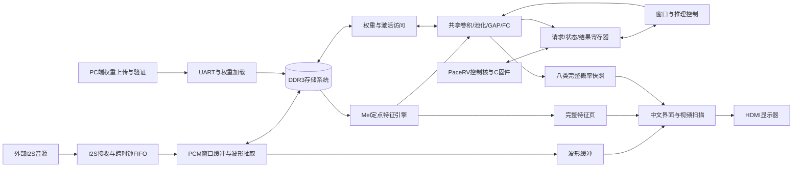
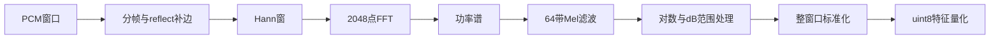
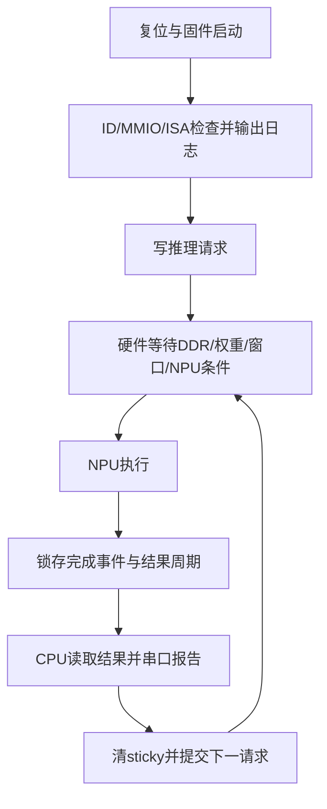
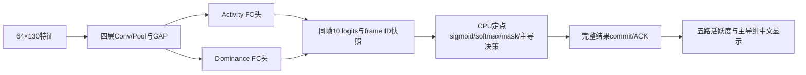
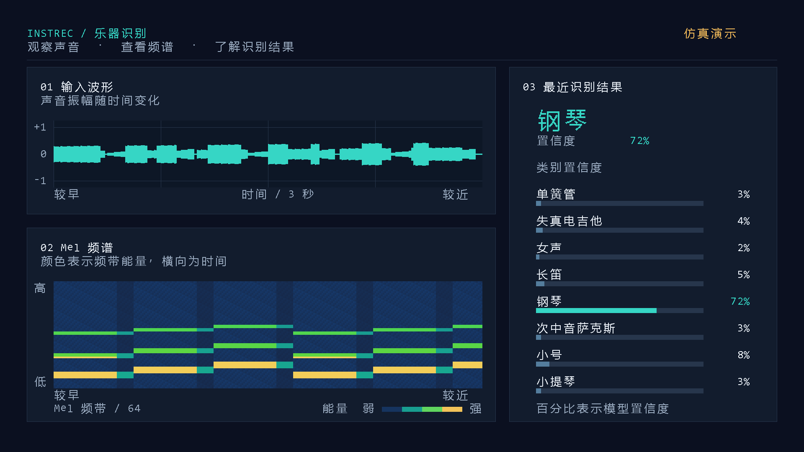

# PaceRV面向音乐音频识别的软硬件协同应用设计与实现

> 2026-11-03定版说明：后续报告统一依据[CPU＋NPU八类固定源码包](../../../releases/pacerv-instrec8-20261103/README.md)，基准提交`0c138d4f`、原始位流`1497FAF4…`。功能范围固定为该版已实现的PCM1808输入、Mel、真实NPU、CPU控制与中文显示，不再纳入五组迁移及演示回放。下方v0.1保留为修订底稿，其旧输入配置、资源及迁移段落不覆盖新定版源码。

> PaceRV中文竞赛报告 · 应用部分 · v0.1 · 2026年11月2日
>
> 本文按完整竞赛报告组织，供后续与CPU部分合稿。CPU内核设计由DYH部分展开，本文负责音频输入、特征提取、神经网络加速、应用控制和可视化。事实基线截至`STATUS.md`的2026年11月2日22:55记录；八类识别为已有实现，五组主导识别与活跃度为正在推进的目标方案。正文保留必要的阶段说明，后续以新测试结果替换。

## 摘要

面向音乐音频的边缘分析需求，本作品在国产FPGA平台上构建PaceRV控制核与专用音频识别加速器协同工作的应用系统。系统将音频采集、DDR3缓冲、Mel频谱提取、定点卷积神经网络和中文HDMI界面连接起来，由RISC-V固件承担推理请求、状态读取与运行记录，专用逻辑执行计算密集的信号处理和神经网络运算。

应用采用盘古100Pro+开发板与PG2L100H器件，设计输入为44.1 kHz、16 bit立体声I2S音频，默认左声道进入识别链路。已有八类系统将音频转换为64×258的Mel特征，通过共享16路乘加阵列完成四层卷积、池化、全局平均池化和全连接运算，并以1920×1080 HDMI显示输入波形、Mel频谱、中文类别及八类置信度。团队建立了独立定点参考、逐层数值对拍、连续窗口仿真和板级日志相互印证的验证流程，重点解决量化舍入、DDR3无反压读流、连续任务状态残留及跨时钟显示一致性问题。

现阶段，真实CPU固件与NPU的两轮不同输入连续仿真通过全部中间结果的golden对拍；完整诊断位流已完成板级启动、DDR3自检、权重上传和六轮推理完成回读，中文界面获得实屏确认。当前完整位流仍存在静态时序违例，真实外部音源尚未接入，因此不将这些结果作为最终准确率或长期稳定性结论。后续在保留八类基线的基础上，迁移至五组双头模型，以主导组为主要结果，同时显示五组独立活跃度，并将定点业务后处理与结果提交交由CPU承担。

**关键词：** PaceRV；RISC-V；国产FPGA；乐器识别；INT8量化；软硬件协同

## 第一部分 作品概述

### 1.1 功能与特性

系统面向音乐片段分析，提供音频输入、频谱计算、乐器识别和本地显示。已有八类实现支持单簧管、失真电吉他、女声、长笛、钢琴、次中音萨克斯、小号和小提琴，显示最近完整识别结果及各类置信度。中文界面同时呈现声音振幅与Mel频谱，便于观察输入、特征和输出之间的关系。CPU运行C固件，控制推理请求并读取状态和结果。后续目标为弦乐、木管、铜管、打击乐、键盘/拨弦五组识别，同时给出主导组与独立活跃度；该功能正在迁移，尚未完成硬件部署。

### 1.2 应用领域

本作品适用于音乐教学展示、音频分类实验和嵌入式人工智能教学。通过将波形、频谱和模型结果放在同一界面中，使用者能够观察不同音色的时频特征，理解音频从采样到分类的处理过程。对于国产FPGA与RISC-V教学平台，系统提供了从模型数值契约、专用加速器到固件控制及显示输出的综合实例。后续五组活跃度可用于混合音乐片段分析，但其模型分数不代表实测声能比例，也不直接构成专业音轨分离或音乐转写能力。

### 1.3 主要技术特点

系统采用通用控制与专用计算分工：CPU运行应用固件，Mel与CNN运算由硬件流水和时分复用计算阵列完成。模型权重存于DDR3并按层装载，片上存储服务于局部数据复用。量化计算以逐层整数契约为依据，统一激活零点、逐通道重标定及round-half-even舍入。显示采用完整特征页和完整结果快照，在视频帧边界提交，维持类别、置信度和像素时序一致。验证同时覆盖数值正确性、连续任务控制、物理实现和板级运行，各类证据分别记录。

### 1.4 主要性能指标

| 指标 | 当前值与依据 |
|---|---|
| 应用器件 | PG2L100H-6IFBG676，盘古100Pro+ |
| 音频接口 | 设计为44.1 kHz、16 bit立体声I2S |
| 视频输出 | 1920×1080，60 Hz设计时序 |
| 八类特征 | 64×258，uint8 |
| Mel计算 | RTL仿真5,144,053周期，按125 MHz折算41.2 ms |
| NPU计算 | native连续仿真31,141,255周期/轮，折算249.1 ms |
| 完整诊断版映射资源 | 33,462 LUT、35,118 FF、147.5 DRM、90 APM |

表1 数值分别来自接口设计、RTL/native仿真和指定版本资源映射，不能合并理解为最终端到端实测。资源对应`2673246E…`诊断版，计算周期对应后续分拍修复源。

### 1.5 主要创新点

1. 将RISC-V控制、定点音频特征、共享CNN计算阵列和中文显示集成，形成可观察的音乐识别应用链路。
2. 将量化参数、舍入、张量布局与DDR3事务统一为可验证契约，支持逐层数值定位。
3. 以完整页发布和帧边界快照连接计算域与显示域，避免部分结果和相邻窗口混显。

### 1.6 设计流程

设计从模型与音频前端契约出发，先建立Python定点参考，再完成I2S、DDR3、Mel、NPU和HDMI模块。通过模块定向验证、不同输入连续窗口对拍、单路PDS物理实现及板级日志逐级检查。当前保留已验证的八类系统，五组迁移依次完成新量化契约、尺寸适配、CPU后处理和显示更新，再进行真实音源验收。

## 第二部分 系统组成及功能说明

### 2.1 系统整体架构

作品由音频数据通路、控制通路和显示通路组成。音频数据从I2S接收器进入跨时钟FIFO，再写入DDR3缓冲。Mel引擎读取完整窗口并产生定点特征，NPU完成卷积网络推理。CPU从本地ROM执行程序，通过MMIO提交请求、查询状态、读取结果和输出日志。显示引擎在像素时钟域扫描波形、频谱与识别结果。



图1 已有八类实现的系统关系。外部音源接口已设计，真实音源接入验收待完成；当前UI直接接收NPU完整概率快照，CPU尚未承担完整向量后处理。

该分工使CPU无需逐样本执行FFT或卷积，也无需逐像素刷新屏幕。CPU负责低数据量的控制，专用硬件承担高吞吐处理。五组迁移将进一步让CPU负责双头输出的业务决策，保持核心算子与视频扫描硬件化。

### 2.2 硬件系统介绍

#### 2.2.1 平台与外部接口

应用使用盘古100Pro+开发板`MES2L676-100HP`，目标器件为`PG2L100H-6IFBG676`。复用板载DDR3、时钟、JTAG和串口资源，通过HDMI发送链路连接显示器，通过FMC扩展IO接入数字音源。应用计算域采用125 MHz工作点，音频时钟发生逻辑使用216 MHz参考，视频链路使用独立像素时钟。

| 接口 | 关键方向及参数 | 作用 |
|---|---|---|
| I2S BCK | FPGA输出，U20 | 位时钟，标称1.4112 MHz |
| I2S LRCK | FPGA输出，T20 | 左右声道选择，标称44.1 kHz |
| I2S SD | FPGA输入，V16 | Philips格式16 bit立体声数据 |
| DDR3 | 板载PHY，用户侧256 bit | PCM、权重及激活中间数据存储 |
| UART | CP2102，115200 bit/s，8N1 | 权重上传、状态和推理日志 |
| HDMI | RGB与同步信号至发送链路 | 1080p中文可视化 |
| KEY0/LED | 复位与状态指示 | 运行、DDR3与异常状态观察 |

表2 应用接口。I2S约束采用3.3 V LVCMOS，音源须支持FPGA提供时钟的从机发送模式；32 bit时隙或主机模式音源不能直接假定兼容。板载HDMI输入芯片的音频输出路径尚未集成本应用，不能将HDMI IN视为已支持的音源。

本阶段复用开发板与接口资源，没有新增机械结构或独立PCB成果。合稿时可补充开发板正面、斜45°全景、FMC音源连接及显示器照片，标明电源、JTAG、串口和音频线；现有报告不以示意图代替实物接线照片。

#### 2.2.2 音频采集与窗口组织

I2S接收按Philips格式处理声道边界与MSB延迟一个BCK的关系。左声道用于模型输入，右声道按接口设计保留为备用数据。异步FIFO将音频采样域与DDR用户时钟域分离，音频写入模块连续组织PCM数据和波形显示所需的降采样结果。

八类模型的标称分析数据量为132,096个采样点，按44,100 Hz折算约2.995 s；最终送入CNN的是64×258特征。STFT的补边、原始帧与保留帧规则由前端实现和golden共同约束，不能仅凭张量宽度反推全部边界行为。连续窗口测试专门检查窗口有效信号释放和下一窗口基址重置，防止首轮正常而第二轮复用旧地址。

五组模型输入为66,150个采样点，约1.5 s，特征为64×130。迁移需要同时修改采集节拍、窗口边界、特征统计与页缓冲尺寸，保持训练前端和硬件前端一致。

#### 2.2.3 DDR3控制与多主仲裁

音频写入、NPU访问、Mel读取和自检共享DDR3。主口固定为m0音频、m1 NPU、m2 Mel、m3自检。模型权重无法全量驻留片上，因此从DDR3按层和通道组加载，片上RAM用于计算所需的局部数据及缓存。

DDR3 IP的用户接口具有专用握手语义：没有标准AXI的`wvalid`、`rready`和B响应通道。写完成按`wready`与最后一个beat共同判断；读通道不能反压，读取方必须保证每拍可接收。控制器封装读前dummy-write，仲裁与NPU桥接保持命令归属直到事务完成，避免共享读流被相邻任务误用。

对这类接口，仅验证最终数据相同仍不充分。设计同时检查命令是否只接纳一次、读写长度是否正确、超时是否释放所有权、最后一拍和完成事件是否对齐。自检读数据增加独立寄存拍，将256 bit数据比较与状态判断分开，缩短组合路径，并保留末拍错误检测和无复位恢复能力。

### 2.3 音频特征提取

Mel引擎按下列顺序处理音频：



图2 音频特征处理流程。hop长度为512，标准化按完整窗口统计。

前端采用定点查表、乘加、移位、除法和开方等硬件结构。`db_norm`与`standardize`通过分拍缩短RAM读出、差值、乘法和量化间的组合路径，寄存数据由状态与valid控制使用，避免对大规模数据路径施加不必要复位。

八类输入量化零点为49，特征存储类型为uint8。其基本关系为：

\[
x_q=\operatorname{sat}_{[0,255]}\left(\operatorname{roundEven}(z/s_{in})+49\right)
\]

其中，\(z\)为标准化特征，\(s_{in}\)取自冻结量化契约。不能把uint8存储直接当作有符号int8解释，也不能在五组迁移时继续沿用旧模型的scale和zero point。

现有RTL回归中，Mel单窗口处理为5,144,053周期，16,512个特征字节与golden零差异。按125 MHz换算约41.2 ms，低于原150 ms计算预算；这属于给定测试条件下的RTL结果，真实音源输入后的特征一致性仍需板级确认。

### 2.4 INT8神经网络加速器

#### 2.4.1 网络结构与计算复用

八类模型采用四层卷积、四级2×2最大池化、GAP和两层全连接。卷积输出通道依次为48、96、192、256，全连接维度为256→128→8。四个逻辑卷积层共享一组16路INT8乘加阵列，以通道组和卷积tap扫描完成计算，减少重复计算器及其控制开销。

| 阶段 | 卷积输出或向量尺寸 | 阶段后尺寸 |
|---|---|---|
| Conv1 / Pool1 | 48×64×258 | 48×32×129 |
| Conv2 / Pool2 | 96×32×129 | 96×16×64 |
| Conv3 / Pool3 | 192×16×64 | 192×8×32 |
| Conv4 / Pool4 | 256×8×32 | 256×4×16 |
| GAP | 每通道64个值 | 256 |
| FC1 / FC2 | 128 / 8 | 8类输出 |

表3 八类模型张量尺寸。池化采用floor规则，奇数宽度的末列不进入输出。

权重DMA将卷积权重和bias、乘子M、shift等参数送入对应引擎。中间激活通过存储与重放结构衔接，按层维护尺寸、地址、数据流有效性和完成事件。NPU层控制器顺序推进卷积、池化、GAP、FC及softmax，CPU不参与逐tap调度。

#### 2.4.2 量化算术契约

每个输出通道的主要计算可写为：

\[
a_c=b_c+\sum_j(x_j-z_{in})w_{c,j}
\]

\[
y_c=\operatorname{sat}_{[0,255]}\left(\operatorname{roundHalfEvenShift}(a_cM_c,s_c)+z_{out}\right)
\]

具体中间位宽、激活限制和融合ReLU按对应层契约执行。实现重点包括：

1. **零点处理。** conv1空间补边填输入零点49，使减零点后的补边为数学零；FC累加正确纳入输入零点与权重和的修正。
2. **偏置来源。** 旧部署文件中的部分`bias_int32.npy`由浮点直接截断产生，不能直接作为硬件偏置。转换流程从模型参数重建有效整数bias，并记录来源。
3. **逐通道重标定。** shift实际范围为37～53，存储宽度至少6 bit。乘子、shift和输出零点逐层加载。
4. **舍入一致。** requant与GAP使用round-half-even，避免多层累积的截断偏差。softmax采用定点概率容器，65535饱和以及百分比取整均有对应语义。

数值参数以`layer_contract.json`为依据，计算行为以`golden_pipeline.py`及RTL回归为依据。早期设计文档中的简单算术右移公式不能代替已修正的舍入实现。本机PyTorch后端存在tile边界数值差异，因此对拍使用冻结的独立golden，并通过额外参考分析区分模型移植错误与后端差异。

#### 2.4.3 实际工作量与预算修正

卷积乘加次数按池化前输出尺寸计算：

\[
MAC=\sum_l H_lW_lC_{out,l}(9C_{in,l})
\]

八类四层卷积合计461,445,120 MAC。早期约114.6 M的估算采用了池化后尺寸，不能作为实际计算量。共享16路阵列还需承担参数切换、输入重放和结果提交，因此完整推理耗时应以周期计数为准。

最新连续native仿真实测31,141,255周期/轮，按125 MHz折算249.1 ms，**仍高于原200 ms NPU预算**。该结果可支撑计算时间评估，不能表述为原预算已经达成，也不能代替真实DDR3和外部音频条件下的板级端到端测量。

### 2.5 CPU与应用固件

#### 2.5.1 当前实现的职责

应用复用PaceRV核心作为控制处理器。当前生产实例关闭M扩展与分支预测，实际运行RV32I配置，具有8 KiB固件ROM和8 KiB本地RAM。CPU不直接访问模型DDR3，不执行Mel、卷积或逐像素绘图；这些职责由专用硬件完成。CPU报告中的通用整数自检也不是CoreMark成绩。

固件启动后读取设备ID，执行MMIO和ISA检查，并通过串口输出启动信息。固件向请求寄存器写入推理请求，顶层保持请求，直到DDR3自检通过、权重有效、Mel完整窗口可用且NPU空闲，才启动一次计算。收到结果后，CPU读取top-1与周期快照，清除sticky标志，再请求下一完整窗口。



图3 当前连续推理正常路径。异常恢复仍需完善，不能由此流程推断已有有限重试和完整故障调度。

| MMIO地址 | 当前用途 |
|---|---|
| `0x80000000` | 设备ID |
| `0x80000004` | busy、done、timeout、概率事件与DDR状态 |
| `0x80000008` | 最近概率事件的类别索引及百分比 |
| `0x8000000C/10` | UART写字节与队列状态 |
| `0x80000014` | LED控制 |
| `0x80000018/1C` | 周期/退休指令计数低32位 |
| `0x80000020` | DDR诊断字段 |
| `0x80000024` | 推理请求与sticky清除 |
| `0x80000028` | 概率事件对应的周期快照 |

表4 CPU应用接口。`0x80000008`只保存最近一次概率流事件，并非完整八类向量；日志中的最后类别及其概率也不能直接当作获胜类别置信度。

#### 2.5.2 五组目标中的CPU职责

五组方案采用两个独立输出头。activity头以五路sigmoid表示各组活跃度，允许多组同时活跃；dominance头产生五组主导分布。参考处理先以activity大于0.5得到mask，再对dominance softmax进行mask与归一化，无活跃组时不强行选择主导组。

新方案拟由NPU产生同一窗口的双头10个定点logit，由CPU完成小规模定点后处理、阈值与无活跃判断、主导组选择和结果提交。硬件显示继续负责实时扫描。该分工使CPU承担可编程的应用决策，同时保留卷积和FC硬件加速。



图4 五组目标方案，尚未完成RTL与固件集成。两套FC参数拟串行复用同一计算引擎。

这项迁移需要新增完整logit快照、frame ID、双头完成位和UI提交接口，不能只改固件或把八条概率条减为五条。可选平滑、迟滞与有限重试属于后续应用策略，应分别验证，避免将平滑结果与原始golden混用。

### 2.6 中文可视化与跨时钟一致性

界面采用三块主要区域：左上为输入波形，左下为Mel频谱，右侧为最近完整识别结果与带中文标签的置信度条。波形用于表示振幅随时间变化；频谱横轴为时间、纵轴为Mel频带、颜色为能量色阶；概率条表示模型置信度。五组版本将分开标注活跃度与主导结果，避免误导为能量占比。



图5 当前八类中文仪表盘。图片来自实际RTL全帧仿真，波形、频谱和概率使用合成夹具，画面带“仿真演示”标识；该图展示渲染能力，不属于真实音频识别效果或实物照片。

显示稳定性依赖数据发布与像素时序同时正确。特征复制引擎将frame-major数据转换为频谱显示所需的行布局，完成整页后发布，像素域在垂直同步边界换页。概率接收端收齐八类后，通过held bundle与request/ack传递完整快照，再在帧边界同时更新类别和各条百分比。

文字与图形通过同步ROM、坐标延迟和寄存绘制实现。最终RGB、DE、HS、VS统一四拍对齐。百分比字符预先并行寄存为glyph包，再由tile选择，缩短选择后十进制格式化路径。首次完整结果产生前，界面显示“等待识别”和`--%`，不将复位类别0显示为实际识别结果。

### 2.7 PC工具与工程验证软件

PC侧工具负责模型参数转换、权重上传、golden计算、RTL回归、构建和证据整理。软件不作为在线卷积计算服务器，应用的目标计算部署在FPGA。

| 工具或资产 | 输入 | 输出及作用 |
|---|---|---|
| `gen_weight_image.py` | 冻结模型参数 | 权重镜像与逐层量化契约 |
| `golden_pipeline.py` | PCM、特征及模型契约 | Mel与CNN各阶段定点参考 |
| `weight_upload.py` | 权重镜像 | UART分帧上传与完成状态 |
| `build_rv32_sw.py` | C固件 | 应用ROM及相关构建资产 |
| `sim/run_sim.py`及native验证程序 | RTL、ROM与测试向量 | 模块、控制和数值回归日志 |
| `render_dashboard.py` | 已纳管的RTL与字图 | 实际RTL界面预览 |
| `run_pds_full.ps1` | 冻结RTL、IP和约束 | 分阶段物理实现与位流清单 |
| `board_check.py` | 指定位流及预期token | 烧录、自检、UART与板级记录 |

表5 开发工具链。具体命令按对应脚本帮助与当前状态文档执行。

构建使用Windows PDS 2022.2-SP6.4，冻结源文件与SHA-256记录构建身份。时序检查覆盖所有时钟域、快慢角的setup、hold及其他已报告要求，不以“位流生成成功”替代时序通过。JTAG流程复用现有服务，脚本正常退出，不终止下载器持有进程。失败构建与诊断位流单独保留，保证历史结果可追溯。

## 第三部分 完成情况及性能参数

### 3.1 工程成果与阶段划分

应用已具备音频接口RTL、DDR3控制、Mel特征、INT8 NPU、CPU固件和中文显示等资产。当前成果需要按实现版本和验证环境分别理解：八类完整诊断系统已上板，后续三项分拍修改已通过功能回归，五组方案完成参考资产冻结与复用评估。

| 成果项 | 完成情况 | 证据边界 |
|---|---|---|
| 音频输入与窗口控制 | RTL与连续窗口验证已有 | 尚未连接真实外部音源 |
| Mel特征引擎 | 给定RTL向量16,512字节与golden一致 | 非真实音源板级精度结论 |
| NPU全链计算 | 两轮不同输入、无复位连续golden通过 | native DDR模型环境 |
| CPU与NPU协同 | 真实固件两轮请求、ACK及下一请求排队通过 | 当前CPU结果接口尚不含完整向量 |
| 中文界面 | 全帧仿真与板上视觉确认已有 | 截图为仿真夹具；不是准确率证据 |
| 完整系统时序 | 当前诊断版FAIL，修复源映射完成但未PNR | 尚无修复源全时序通过结论 |
| 五组双头模型 | float资产冻结、五样本参考复核完成 | 新INT8契约及硬件推理未完成 |

表6 当前成果总览。

实物成果以现有开发板、显示器及下载调试连接构成，没有独立机械制作或新PCB。最终合稿应补入真实音源接入后的系统照片、音源接口近照及显示实拍，同时记录对应位流和模型版本。本稿保留这些材料位置，不使用其他工程照片替代。

### 3.2 数值正确性与连续推理验证

连续任务验证使用已纳管的生产ROM与真实CPU执行，NPU读取frame-major特征，DDR3侧采用native模型。相邻A、B窗口的全部16,512个特征字节改变，中间不复位。测试逐值检查conv、pool、GAP、FC、logits与概率，全部与golden一致，CPU完成两次请求与ACK，并排队第三次请求。

两轮NPU实测均为31,141,255周期。CPU记录的事件周期为31,141,254，与测试台的区间边界口径差一拍；报告保留两种原始计数，不将其解释为不确定执行。数据及源hash见`cpu_native_store_replay_pipeline_20261102.json`。

连续窗口测试比单次复位启动更能暴露计数残留、地址未归零、有效位未清除和旧结果误提交。验证还覆盖NPU完成握手、顶层控制、DDR超时及自检恢复。已有分拍修复的回归记录为pytest 433 passed、4 skipped，RTL词法检查61个文件、0违规；这些是对应版本的归档结果，本报告撰写未重新运行全部硬件回归。

### 3.3 显示验证

中文仪表盘实际RTL输出等待、正常、零值、满量程和越界钳位五种完整帧，总计10,368,000个有效像素。测试核对像素计数、同步四拍延迟、波形缩放、64×258特征的显示方向与覆盖范围、RAM边界和条形内部颜色。输入百分比100与255经过钳位后，全帧输出逐字节一致。

跨时钟显示测试检查两窗口特征页复制、读口stall、完整页提交和首次未就绪屏蔽；结果侧检查部分概率流拒绝、完整快照提交和帧中保持。用户已确认完整诊断版中文仪表盘正常且稳定显示，该观察对应当次实屏反馈，不能替代长时稳定性与电气验证。

### 3.4 板级运行结果

当前已确认的完整八类诊断位流SHA-256为：

```text
2673246ECAC0ECB3E00721C53EFD6B941CC0E8CA44022064AE36C21941D89318
```

该位流program成功，状态为done=1、CRC错误标志为0。新设计启动后实收`RV32 BOOT`、`RV32 MMIO OK`、`RV32 ISA OK`及`DDROK`。691,040字节权重以2,700帧上传，返回`WOK FA0D5236`和上传完成信息；随后12秒捕获中观察到六次NPU完成与CPU结果回读，每轮报告约3,236万周期。

权重上传返回WOK支持当前传输与校验闭环，推理完成日志支持硬件和CPU控制流程持续推进。由于没有真实外部音源和对应标准答案，这六轮完成不能解释为六段音频识别正确；也不能用它计算分类准确率。最新分拍源native周期与板上旧位流周期属于不同版本和环境，不据此直接报告性能提升。

### 3.5 资源占用与时序结果

| 资源 | 当前诊断版完整映射 | 器件容量 | 占比 |
|---|---:|---:|---:|
| LUT | 33,462 | 66,600 | 50.2% |
| FF | 35,118 | 133,200 | 26.4% |
| DRM | 147.5 | 155 | 95.2% |
| APM | 90 | 240 | 37.5% |

表7 `20261102-211104-aedccc03`完整诊断版的资源门控结果。DRM按PDS原生计数，保留半块表示，不以不同构建集的资源数字拼接成本表。

当前片上存储余量较小，且超出早期108 DRM的资源预算；后续尺寸压缩或缓冲复用需要通过新源映射证实。不能因LUT仍有余量就判断整体物理实现余量充足。

| 当前诊断版时序检查 | 最差余量 | 违例端点数 |
|---|---:|---:|
| slow像素域setup | −2.708 ns | 32 |
| slow核心域setup | −1.267 ns | 1,393 |
| slow核心域hold | −0.011 ns | 1 |
| fast核心域hold | −0.009 ns | 1 |

表8 已确认的时序违例，完整结论为FAIL。

后续源分别对百分比字形生成、DDR自检比较、NPU激活存储至卷积输入进行分拍。功能回归表明数值或显示输出保持一致，截至22:55记录，新源已完成compile、synthesize和dev_map，映射为33,640 LUT、35,394 FF、153.5 DRM和90 APM，DRM仅余1.5块；本轮止于资源门控，没有启动PNR，没有新的完整时序结论或位流。本稿不把修复意图写成收敛结果，也不将M0/M1等早期裁剪配置的正裕量用于证明当前完整系统。

### 3.6 五组迁移目标与验收安排

五组模型顺序固定为弦乐、木管、铜管、打击乐、键盘/拨弦。其64×130输入经四次池化形成256×4×8张量，GAP每通道平均32个值。卷积通道与八类版本相同，但空间尺寸、统计域、重放地址、量化参数、FC双头调度及UI语义均需同步更新。

五组理论卷积MAC为231,413,760，约为八类的50.2%；若采用纯INT8权重，双头纯权重共716,976字节，尚未计入bias、重标定和对齐开销。该数据用于容量与工作量分析，不是新硬件推理时间或新模型准确率。

迁移验收按以下次序推进：

1. 冻结训练来源、模型和校准数据，完成BN折叠、新INT8契约及留出集float/INT8对照，分别评估activity与主导组。
2. 使66,150采样点、130帧、补边和整窗口统计与新golden一致，再验证卷积、池化、激活重放及GAP尺寸。
3. 复用FC引擎执行双头，新增CPU完整快照与提交通道，覆盖多活跃、无活跃、阈值附近和不同连续窗口。
4. 更新五行活跃度和主导结果界面，完成实际RTL全帧检查、新源资源与全时序门控，再进行板级闭环。
5. 接入兼容音源，保存输入片段、PCM、特征、双头结果和显示记录，测量准确率、混合场景表现、端到端延迟和持续运行稳定性。

五个冻结float参考样本已复核双头logit逐值一致，此结果验证资产重载与参考路径，不等同新模型留出集精度。当前没有五组硬件推理通过的证据。

## 第四部分 总结

### 4.1 可扩展之处

系统可在既有CPU、DDR3和HDMI框架上扩展五组双头识别，由CPU承担定点后处理、阈值配置和结果管理。后续可加入结果帧号、错误恢复、可选平滑和更多外设交互。针对有限片上存储，可探索窗口尺寸参数化、缓冲复用与按层资源核算。音源兼容性、真实数据精度和全系统时序收敛仍需独立验证，完成后再评估更高刷新率或更复杂模型。

### 4.2 设计总结与心得体会

本应用将PaceRV从独立处理器平台扩展到可控制专用AI计算链路的音乐分析系统。工程的主要工作集中在模型语义、硬件接口与任务生命周期的连接：采样窗口是否与训练前端一致，量化偏置和零点是否正确，DDR3读流能否持续接收，连续窗口是否释放旧状态，以及显示是否只提交完整结果。

量化移植过程中，文件类型相同并不保证数值语义正确。偏置导出中的浮点截断、shift位宽不足、补边未填零点和舍入规则偏差，都可能让流水线正常结束却产生错误结果。通过独立golden与逐层检查，问题能够定位到具体算子和数值边界，而不必仅凭最终类别判断。

系统集成同样需要关注任务归属。请求被接纳、数据有效、最后一拍到达和完成事件发生，属于不同的接口时刻。单次复位运行可能掩盖状态残留，改变全部特征的连续窗口测试能够揭示跨轮次问题。显示侧采用完整页与完整结果快照，则把这一原则延伸到跨时钟域和视频帧边界。

物理实现还表明，功能仿真、位流生成、屏幕可见和静态时序通过是不同层次的成果。片上RAM接近容量上限时，数据选择、地址路径与长距离布线都会影响最终实现。分拍修复必须重新绑定源码、资源和时序证据，不能仅以回归通过结束验证。

当前应用已积累八类系统的数值、控制和显示基线。五组迁移将以此为基础，进一步明确CPU的业务职责，使专用硬件完成高吞吐计算、固件完成可配置决策。最终成果应由真实音源、完整时序和连续运行测试共同支撑。

## 第五部分 参考文献

[1] PaceRV团队. PaceRV高性能RV32IMC处理器设计与实现[EB/OL]. DYH分支，提交`4ef1ea1be32c110024dd59f08f1342b325c9df59`，2026-11-02查阅. [CPU竞赛报告](https://github.com/BXSYGJ/ZGTC_RISC_CPU/blob/4ef1ea1be32c110024dd59f08f1342b325c9df59/docs/competition/cpu-report/CPU_REPORT.md).

[2] PaceRV团队. PaceRV处理器开源实现[EB/OL]. [https://github.com/BXSYGJ/PaceRV](https://github.com/BXSYGJ/PaceRV).

[3] InstRec-FPGA项目组. 实时乐器识别系统需求、设计与任务说明[Z]. 2026. 工程内`docs/sdd/spec.md`、`design.md`、`tasks.md`；后续实现修正以实时状态及数值契约为准.

[4] InstRec-FPGA项目组. 定点参考计算与量化层契约[CP]. 2026. `scripts/golden_pipeline.py`；`scripts/outputs/layer_contract.json`.

[5] InstRec-FPGA项目组. 五类主导乐器迁移与CPU分工评估[Z]. 2026-11-02. `docs/GROUP5_REUSE_AND_CPU_ASSESSMENT_20261102.md`.

[6] Philips Semiconductors. I2S Bus Specification[S]. 1986, revised 1996.

[7] IRMAS项目. IRMAS: a dataset for instrument recognition in musical audio signals[DB/OL]. [https://www.upf.edu/web/mtg/irmas](https://www.upf.edu/web/mtg/irmas).

## 附录A 主要证据索引与合稿说明

本附录用于继续维护报告，正式合稿时可精简。路径均相对`instrec_fpga/`。

| 本文内容 | 主要依据 |
|---|---|
| 当前已实现与未完成边界 | `docs/STATUS.md`，本稿采用22:55及之前记录 |
| CPU内核报告结构参考 | DYH固定提交中的`docs/competition/cpu-report/CPU_REPORT.md` |
| 模板与远程来源身份 | 本目录`SOURCES.json` |
| 最新CPU/native连续逐层对拍 | `reports/cpu_native_store_replay_pipeline_20261102.json` |
| 分拍源回归与静态检查 | `reports/store_replay_pipeline_validation_20261102.json` |
| 中文UI五状态实际RTL输出 | `reports/ui_dashboard_validation_20261102.json`及对应PNG |
| 指定完整位流及资源 | `reports/ui_dashboard_full_build_20261102.json` |
| 最新分拍源资源门控 | `reports/replay_pipeline_resource_gate_20261102.json` |
| 全部时序要求 | `reports/ui_dashboard_full_timing_20261102.json` |
| 板级启动、上传、推理与视觉反馈 | `reports/board_dashboard_20261102_2155.json` |
| 五组参考资产与复用评估 | `models/group5_v3_float_20261102/`、`reports/group5_reuse_assessment_20261102.json` |

与CPU部分合稿时，CPU微架构、CoreMark与论文成果保留在DYH章节；本文的125 MHz应用配置、100H资源及推理周期独立标注。DYH报告中的200H、RV32IMC和CoreMark数据不迁移为本应用性能。本稿没有复用其SOTA表述，也未将CPU论文成果归为应用识别效果。

后续优先替换三类内容：完整系统收敛后的资源与时序表、真实音源下的识别及延迟数据、五组迁移完成后的架构与实测。截图须注明仿真或实拍，模型指标须注明数据集、样本量与版本；以新证据修订正文时，同时更新本附录及来源清单。
