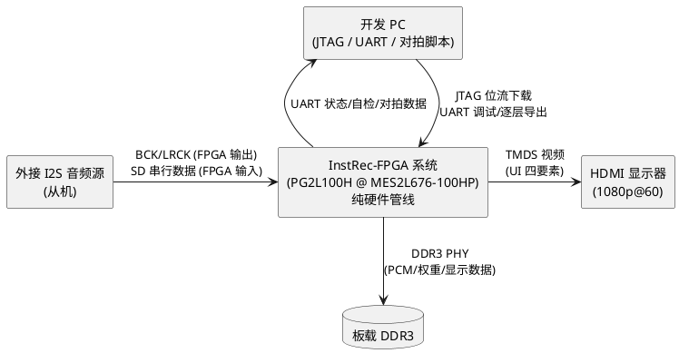
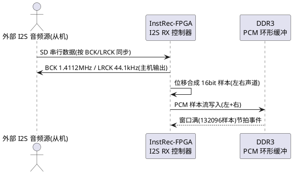
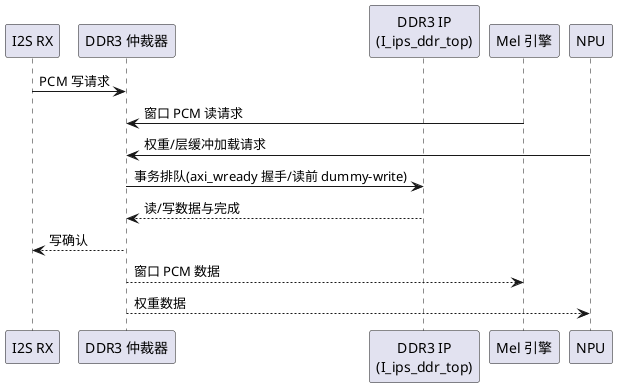
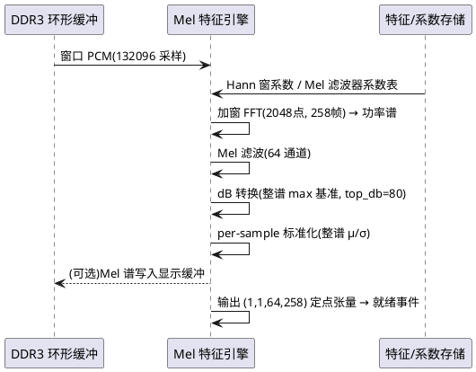
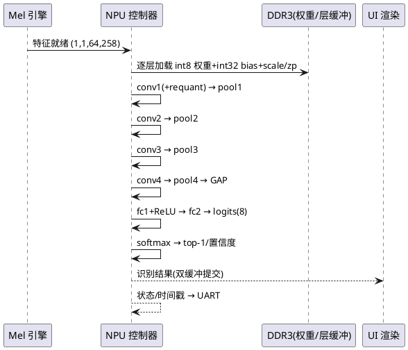
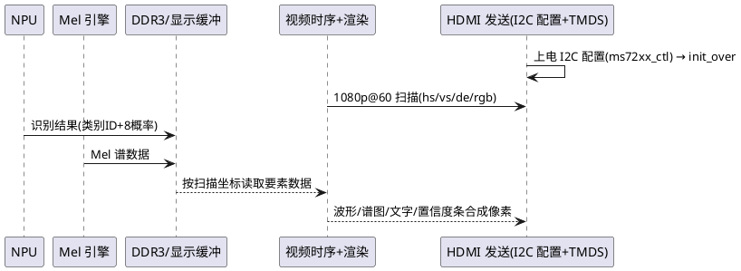
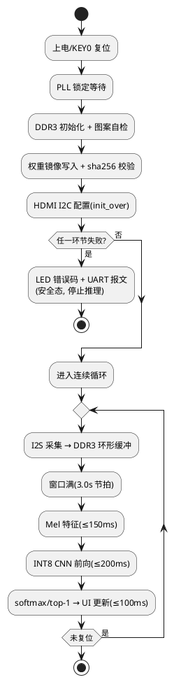

# InstRec-FPGA 实时乐器识别系统需求规格说明书

| 项目 | 内容 |
| ---- | ---- |
| 文档标识 | spec.md / instrec_fpga |
| 版本 | v1.0 |
| 日期 | 2026-10-26 |
| 作者 | 需求规格工程师（李工） |
| 状态 | 已定稿（依据用户预授权：按默认与最推荐方案执行，不再追问需求） |
| 目标器件 | 紫光同创 Logos2 `PG2L100H-6IFBG676`（-6 速级，FBG676 封装） |
| 目标板卡 | 盘古 100Pro+ 开发板 `MES2L676-100HP` |
| 工程落盘 | `D:\0000\111\001\Pango\ZGTC_RISC_CPU\instrec_fpga\`（独立新建，不污染既有工程） |
| 需求真源 | 见 §1.2 与 §10.3 真源文件清单 |

---

# 1. 组件定位

## 1.1 核心职责

本组件负责将 InstRec 乐器识别 AI 模型（8 类乐器，INT8 静态量化 CNN）以纯 FPGA 硬件管线形式部署到盘古 100Pro+ 开发板，实现从 I2S 音频输入到 HDMI 可视化识别结果的端到端实时推理，全程无软核 CPU 参与。

## 1.2 核心输入

1. **I2S 三线音频流**（来源：外接 I2S 音频源，经 FMC 扩展 IO 通用引脚接入）：BCK、LRCK 为 FPGA 输出（主机模式），SD 为 FPGA 输入；44.1 kHz 采样率、16 bit、立体声。
2. **板载 27 MHz 系统时钟**（引脚 D18）：全部用户逻辑时钟树的参考源。
3. **差分 125 MHz DDR3 参考时钟**（引脚 N3/N2）：DDR3 PHY IP 参考。
4. **板载按键**：KEY0（C22，低有效复位）、KEY1（C23，低有效，自检/导出触发）。
5. **模型部署资产**（来源：`D:\0000\111\001\Pango\InstRec\deploy\`，构建期离线转换）：INT8 权重、逐层 scale/zero_point、类别表、特征参数。
6. **已打通工程资产**（来源：本仓库）：`pds_cpu_100h/ipcore/ddr3_test`（DDR3 IP）、`pds_cpu_100h/constraints/ddr3_100h.fdc`、`pds_cpu_100h/scripts/gen_ddr3_fdc.py`。
7. **官方 HDMI demo 资产**（来源：`docs/盘古100Pro+开发板（MES2L676-100HP）配套资料/7_FMC扩展子卡/2_Demo/da_ad_HDMI/ad9280_ad9708_HDMI/`）：时序发生、HDMI 发送芯片 I2C 配置、显示叠加模块。

## 1.3 核心输出

1. **HDMI 视频输出**（1080p@60Hz，24 位 RGB TTL 时序 + TMDS 串化，含 4 类 UI 元素）：实时波形、Mel 频谱图、识别类别中文名、8 类置信度条。
2. **UART 调试输出**（板载 CP2102，B24/C24，115200 8N1）：系统状态、自检结果、逐层中间结果导出（对拍用）。
3. **LED 状态指示**（A20/C18/C19/E18/A17/A18/C17/B17 中至少 4 个）：系统运行/错误状态编码。
4. **识别结果数据**（片内）：top-1 类别 ID、8 类 softmax 概率，供 UI 与导出使用。

## 1.4 职责边界

本组件**不负责**以下事项：

1. 不做 PCB 视觉项目的任何移植与延续（该方向已按用户指令停止）。
2. 不引入软核 CPU（RV32 或其他）参与数据通路；纯 FPGA 硬件状态机管线。
3. 不做 5 组多标签 / 双头模型（`DualHeadInstrumentCNN`、`N_FRAMES_SHORT=130` 短窗口路径均为非目标）；仅部署 deploy 目录现成的 8 类单标签模型。
4. 不做 Flash 固化与上电自启动；验证与演示一律采用 JTAG RAM 下载位流。
5. 不做音频前端模拟调理（AGC、麦克风偏置、驱动喇叭等）；模拟侧由外部 I2S 音频源自理。
6. 不做模型训练、量化校准、权重再生成；权重以 `InstRec/deploy/weights/*.npy` 为唯一真源离线转换。
7. 不修改既有 `cpu/`、`pds_cpu_100h/` 工程文件；DDR3/HDMI 资产以复制方式引用。
8. 不做本地 RTL 仿真环境建设（本机无 WSL / 无 Icarus）；验证走 Python 定点对拍 + 板级实测。

---

# 2. 领域术语

**I2S**
: 一种三线（BCK 位时钟 / LRCK 帧时钟 / SD 串行数据）的数字音频传输总线；本系统中 FPGA 为主机（输出 BCK/LRCK），外部音频源为从机。

**BCK**
: I2S 位时钟。本系统 44.1 kHz × 16 bit × 2 声道 = 1.4112 MHz。

**LRCK**
: I2S 帧（字）时钟，频率等于采样率 44.1 kHz；Philips I2S 标准约定低电平为左声道。

**分析窗口（Analysis Window）**
: 一次完整推理所消费的 PCM 采样集合：258 帧 × 512 hop = 132 096 个采样，时长约 2.9965 s（下文按 3.00 s 计）。

**PCM 环形缓冲（PCM Ring Buffer）**
: 位于 DDR3 的循环覆盖式音频样本存储区，持续写入最新音频，供特征引擎按窗口截取。

**Mel 特征（Mel Spectrogram）**
: 经 STFT → 功率谱 → Mel 滤波 → dB 对数 → per-sample 标准化后的二维特征张量，形状 (1, 1, 64, 258)，为 CNN 的唯一输入。

**per-sample 标准化**
: 以整张 64×258 频谱图的均值和标准差对该谱图做零均值单位方差归一（含 eps=1e-6 下限），是参考实现 `src/features.py` 的默认行为。

**INT8 静态量化**
: 权重 per-channel 对称量化（qint8）、激活 per-tensor 仿射量化，离线校准（500 样本，fbgemm 引擎）后固化 scale/zero_point 的量化方式。

**conv+bn+relu 融合**
: PyTorch fuse_modules 将卷积、BatchNorm、ReLU 合并为单一量化算子的导出形式；BN 参数已折入权重与偏置。

**NPU**
: 本组件内实现 INT8 CNN 前向推理的硬件加速子系统（卷积/池化/全连接/量化重标定）。

**逐层对拍（Per-layer Bit-match Check）**
: 将 RTL/板级逐层输出与 PyTorch 量化参考模型对应层输出做数值一致性比对的验证方法。

**top-1**
: softmax 概率最大的类别；本系统输出其类别 ID、中文名与置信度。

**DRM**
: 紫光 Logos2 器件的块状 RAM 单元（每块 18 Kb）；PG2L100H 共 155 块。

**APM**
: 紫光 Logos2 器件的算术处理模块（乘加硬核）；PG2L100H 共 240 个。

**sbit**
: PDS 工具输出的 FPGA 位流文件格式，经 JTAG 下载至 RAM 运行。

---

# 3. 角色与边界

## 3.1 核心角色

1. **演示操作员（竞赛评委/观众）**：向 I2S 音频源发声或播放音频；观看 HDMI 显示的识别结果。无其他交互。
2. **开发/验证工程师（许书语、代奕航、周银锋）**：经 JTAG 下载位流、经 UART 读取自检与逐层导出、运行 Python 对拍脚本、用示波器测量 I2S 时钟。

## 3.2 外部系统

1. **外接 I2S 音频源**：I2S 从机设备（如 I2S 麦克风模块 / 音频编解码子卡 / 信号源），接收本系统输出的 BCK/LRCK，回传 SD 串行数据；供电与模拟调理自理。
2. **HDMI 显示器**：接收 1080p@60 视频并显示 UI。
3. **开发 PC**：经 USB Cable II（JTAG，J12 口）下载位流；经板载 CP2102 串口（USB Type-C）收发调试数据；运行 PDS 批处理与 Python 对拍脚本。
4. **DDR3 SDRAM（板载）**：经 DDR3 PHY IP 交互，承载 PCM 环形缓冲、模型权重与显示辅助数据。

## 3.3 交互上下文

---

# 4. DFX 约束（EARS 需求）

## 4.1 性能需求（REQ-PRF）

性能指标由 44.1 kHz / 258 帧 / 512 hop 的窗口数学推导得出：窗口时长 = 258 × 512 ÷ 44100 ≈ 2.9965 s ≈ 3.00 s；CNN 前向 INT8 MAC 总量 ≈ 114.6 M（conv1 1.78 M + conv2 42.47 M + conv3 42.47 M + conv4 28.31 M + fc1 0.033 M + fc2 0.001 M）。

| ID | EARS 需求 | 验收标准 |
| ---- | ---- | ---- |
| REQ-PRF-001 | The system shall 以分析窗口节拍（3.00 s）连续触发完整推理，即相邻两次推理启动的时间间隔 ≤ 3.0 s。 | 板级连续运行 ≥ 60 s，UART 打印每次推理启动时间戳，任意相邻间隔 ∈ [2.9, 3.1] s。 |
| REQ-PRF-002 | The system shall 保证端到端识别延迟（窗口最后一个采样进入 I2S RX → HDMI 显示该窗口识别结果）≤ 3.5 s。 | 板级以已知时间点音频事件（如拍手沿）对表测量，10 次测量最大值 ≤ 3.5 s。 |
| REQ-PRF-003 | The system shall 在以下分阶段预算内完成单窗口处理：Mel 特征提取 ≤ 150 ms，CNN 前向推理（含权重加载）≤ 200 ms，UI 结果更新渲染 ≤ 100 ms。 | 各阶段以片内时间戳寄存器计量并经 UART 导出；连续 10 窗口各阶段最大值不超过对应预算。 |
| REQ-PRF-004 | The system shall 在 1080p@60 视频时序下维持 UI 有效刷新率 ≥ 10 fps（可见动态元素更新周期 ≤ 100 ms）。 | 板级以高速摄像或逐帧计数验证波形区相邻更新间隔 ≤ 100 ms；UI 无整屏撕裂或长时间静止（>200 ms）。 |
| REQ-PRF-005 | The system shall 将 DDR3 访问总带宽占用控制在 ≤ 285 MB/s（音频写入 0.18 + 权重加载 ≤ 230 + 特征与显示读 ≤ 55 MB/s 预算分解），保证任一引擎不因仲裁饿死。 | 设计期以事务计数模型核算各主设备峰值带宽并交付核算表；板级通过仲裁等待计数器导出验证任一引擎单窗口仲裁等待时间 ≤ 该引擎时间预算的 10%。 |

## 4.2 资源需求（REQ-RSC）

器件容量依据官方 demo PnR 报告核实：LUT 66 600（CLMA 46 700 + CLMS 19 900）、FF 133 200、DRM 155 块（约 2.7 Mb）、APM 240、GPLL 6、DDR PHY 4 组。

| ID | EARS 需求 | 验收标准 |
| ---- | ---- | ---- |
| REQ-RSC-001 | The system shall 将用户逻辑 LUT 占用控制在 ≤ 53 000（器件 66 600 的 80%）。 | PDS pnr 报告 Device Utilization：LUT 合计 ≤ 53 000。 |
| REQ-RSC-002 | The system shall 将 FF 占用控制在 ≤ 66 600（50%）、GPLL 占用 ≤ 4 个（含 DDR3 PHY 的 2 个 GPLL）。 | PDS pnr 报告：FF 合计 ≤ 66 600；GPLL ≤ 4。 |
| REQ-RSC-003 | The system shall 将 DRM（块 RAM）占用控制在 ≤ 108 块（155 块的 70%），并保证时序收敛优先于利用率压缩。 | PDS pnr 报告：DRM ≤ 108 且 All Constraints Met。 |
| REQ-RSC-004 | The system shall 将 APM（DSP）占用控制在 ≤ 144（240 的 60%）。 | PDS pnr 报告：APM ≤ 144。 |
| REQ-RSC-005 | 由于 INT8 权重总量约 0.69 MB（≈5.5 Mb，含逐层 scale/zero_point 元数据 728.56 KB）超过片上 DRM 总容量（155 × 18 Kb ≈ 2.7 Mb），the system shall 将全部模型权重存储于 DDR3，并按层/分块加载至片上级联缓冲执行计算，禁止假设权重可全量驻留片上。 | 权重初始化镜像经 DDR3 写入并回读校验（sha256 比对）；NPU 逐层计算期间观察 DDR3 权重读流量非零；片上权重缓冲规模 ≤ 32 KB/层。 |
| REQ-RSC-006 | The system shall 将 DDR3 空间占用控制在 ≤ 32 MB（PCM 环形缓冲 + 权重 + 显示辅助数据）。 | 地址映射表交付并经 DDR3 自检窗口（图案写读）覆盖全部占用区间。 |

## 4.3 精度对拍需求（REQ-ACC）

对拍基准为 `InstRec/deploy/inference_reference.py`（TorchScript 量化模型，fbgemm 引擎）与 `src/features.py`（librosa 浮点参考）。参考精度基线：INT8 测试集准确率 77.37%（FP32 77.84%，下降 0.47%）。

| ID | EARS 需求 | 验收标准 |
| ---- | ---- | ---- |
| REQ-ACC-001 | The system shall 保证 Mel 特征引擎的定点输出与 librosa 浮点参考（`extract_mel`，per_sample 归一化后）在归一化数值域上逐元素一致：全 64×258 元素最大绝对误差 ≤ 0.05 且 Pearson 相关系数 ≥ 0.999。 | Python 定点参考模型对 ≥ 20 条测试音频对拍，全部满足两项指标；测试报告归档（样本清单 + 误差统计）。 |
| REQ-ACC-002 | The system shall 保证 CNN 各 INT8 量化层输出与 PyTorch 量化参考逐层一致：每个量化层 int8 输出张量 100% 元素落在参考值 ±1 LSB 内。 | Python 定点模型逐层 dump（conv1~conv4、fc1、fc2 输出）对拍 ≥ 100 个特征样本，逐层统计并输出报告。 |
| REQ-ACC-003 | The system shall 保证最终 logits 与 softmax 概率与 PyTorch 量化参考一致：max\|Δlogit\| ≤ 0.25、softmax max\|Δp\| ≤ 0.02，且 top-1 类别一致率 ≥ 99%。 | 同 REQ-ACC-002 样本集上统计三项指标全部达标。 |
| REQ-ACC-004 | The system shall 保证推理结果确定性：同一输入特征（含权重、逐层 scale/zero_point 不变）重复推理，8 类 logits 逐位完全一致。 | 板级对同一音频文件回放 10 次，UART 导出 logits 十六进制完全相同。 |
| REQ-ACC-005 | The system shall 保证板级端到端识别结果与 `inference_reference.py` 的 Python 端到端结果一致：在 ≥ 20 条覆盖 8 类的测试音频上，板级 top-1 与 Python top-1 一致率 ≥ 90%（差异样本须归因并记录）。 | 板级实测 + Python 参考输出比对报告；每类至少 2 条样本。 |

## 4.4 构建与工具链需求（REQ-BLD）

| ID | EARS 需求 | 验收标准 |
| ---- | ---- | ---- |
| REQ-BLD-001 | The system shall 经 Windows PDS 2022.2-SP6.4 批处理（`pds_shell.exe -file build_full.tcl`，PDS_ROOT=H:\GG\pango\PDS_2022.2-SP6.4，PANGO_LICENSE_FILE=E:\License\pango\new_pds_F4A80DA47D72.lic）完成 compile → synthesize → dev_map → pnr → report_timing → gen_bit_stream 全阶段，任一阶段无 Error。 | 构建日志归档；`C: Bitstream-2001: SCBV has not been set` 按已知警告豁免；产出 `instrec_fpga/build/…/generate_bitstream/<top>.sbit` 并记录 sha256。 |
| REQ-BLD-002 | The system shall 在 pnr 后时序收敛（All Constraints Met），setup/hold WNS/WHS 均 ≥ 0。 | `report_timing` 结果归档；任何 Some Constraints Violated 即为验收失败。 |
| REQ-BLD-003 | 全部 RTL shall 遵循 SystemVerilog-2005（PDS 不支持 SV-2012：使用 `always @*`、无隐式 `logic`、无 SV-2012 语法），标识符 snake_case、参数名全大写、注释一律英文，顶层端口禁止 `.port()` 空连接。 | 静态检查脚本（lint 清单）通过；抽查无违例。 |
| REQ-BLD-004 | 工程文件 shall 全部落盘于 `instrec_fpga/` 独立目录（src/ constraints/ ipcore/ scripts/ build/），不得修改 `cpu/`、`pds_cpu_100h/` 等既有工程内容；DDR3 IP、约束、HDMI demo 模块以复制方式引入并保留原实例层级语义（DDR3 IP 实例名必须为 `I_ips_ddr_top`）。 | git diff 显示既有工程目录零改动；复制资产溯源清单归档。 |
| REQ-BLD-005 | The system shall 支持以 JTAG（USB Cable II，J12 口，cdt_cfg 或 PDS Configuration GUI）RAM 下载 `.sbit` 位流后直接运行，不依赖任何 Flash 固化步骤。 | 板级演示全流程仅含「下载位流 → 复位 → 运行」三步并可重复执行。 |

## 4.5 可靠性需求（REQ-REL）

| ID | EARS 需求 | 验收标准 |
| ---- | ---- | ---- |
| REQ-REL-001 | When 上电或 KEY0 复位释放，the system shall 依序完成 PLL 锁定 → DDR3 初始化 → 引擎就绪自检后自动进入采集-推理循环；任一环节失败则停留于安全态并以 LED 错误码与 UART 错误报文指示，不得输出虚假识别结果。 | 板级分别制造 PLL 未锁/DDR3 失败注入（拔/换条件或强制复位序列），观察 LED 错误码与 UART 报文，且 UI 不显示伪造类别。 |
| REQ-REL-002 | When 任一处理阶段耗时超过其预算（REQ-PRF-003）的 2 倍，the system shall 置超时标志、经 UART 告警并将该阶段状态机复位重入，不得挂死整个流水线。 | 注入慢条件（如调试降频）验证超时路径触发与恢复；连续 60 s 无挂死。 |
| REQ-REL-003 | While I2S SD 输入持续为静音（全 0 或全 1）或无数据翻转，the system shall 维持管线运转并将 UI 置于静音提示状态（波形平线、置信度条全 0 或保持历史值并标注静音），不得崩溃或复位。 | 板级拔掉 I2S 源 SD 线 30 s：系统不复位、恢复输入后 1 个窗口内恢复正常显示。 |

## 4.6 可维护性与可测性需求（REQ-MNT）

| ID | EARS 需求 | 验收标准 |
| ---- | ---- | ---- |
| REQ-MNT-001 | The system shall 经板载 UART（B24/C24，115200 8N1）输出上电自检结果、各阶段时间戳、推理结果摘要，格式为可被 Python 解析的行式文本。 | 板级采集 UART 日志 ≥ 60 s；`instrec_fpga` 对拍脚本可解析全部行类型。 |
| REQ-MNT-002 | When KEY1（C23）按下，the system shall 经 UART 导出最近一次推理的逐层中间结果（Mel 谱与 CNN 各量化层输出）供离线对拍。 | 板级导出数据与 Python 定点模型比对满足 REQ-ACC-001/002 对应指标。 |
| REQ-MNT-003 | The system shall 以 ≥ 4 个 LED 表征系统状态（至少含：运行心跳、DDR3 OK、推理进行、结果有效）。 | 板级观察四类状态各自可辨识；心跳闪烁周期 0.5~2 s。 |

---

# 5. 核心能力（EARS 需求）

## 5.1 音频采集（I2S 输入）

### 5.1.1 业务规则

| ID | EARS 需求 | 验收标准 |
| ---- | ---- | ---- |
| REQ-AUD-001 | The system shall 在 FMC 扩展 IO 通用引脚上以主机模式实现 I2S 三线接口：BCK、LRCK 为输出，SD 为输入，电平 LVCMOS33（VCCIO 3.3 V）。 | 原理图/引脚表核对：三引脚位于 FMC 可用通用 IO 且与 HDMI（§5.5 引脚清单）、DDR3 73 针、板载专用引脚零冲突。 |
| REQ-AUD-002 | The system shall 输出 LRCK = 44.1 kHz（采样率家族锁定 44 100 Hz）、BCK = 1.4112 MHz（44.1 kHz × 16 bit × 2 声道），并按 16 bit 立体声接收 SD 数据。 | 示波器实测 LRCK、BCK 频率与占空比（50%）；逻辑分析仪解码确认帧格式。 |
| REQ-AUD-003 | The system shall 保证 BCK 与 LRCK 的绝对频率误差 ≤ ±500 ppm（对 44.1 kHz 标称），以控制采样率偏差对 Mel 频率轴标定的影响。 | 示波器/频率计实测 60 s 累计误差折算 ppm ≤ 500。 |
| REQ-AUD-004 | The system shall 采用 Philips 标准 I2S 数据格式：LRCK 低电平为左声道字、MSB 在前、数据相对 BCK/LRCK 边界的相位遵循 I2S 规范（数据延迟 1 个 BCK）。 | 逻辑分析仪按 I2S 协议解码出左右声道 16 bit 样本与已知信号源值一致。 |
| REQ-AUD-005 | The system shall 将左声道样本默认送入识别数据通路（InstRec 为单声道模型训练），右声道样本仅写入 DDR3 备用存储，不参与特征提取。 | 回放仅左/仅右含已知内容的测试音，确认识别通路仅响应左声道；DDR3 备用区右声道数据回读正确。 |
| REQ-AUD-006 | I2S 三个引脚的具体引脚号 shall 在设计阶段从 FMC 子卡原理图/资料中选定并记录于约束文件，选取原则为通用 IO、走线最短、与已占用引脚避让。 | `instrec_fpga/constraints/*.fdc` 中三引脚约束齐全（LOC/VCCIO/STANDARD/DIRECTION），选型依据记录于设计文档。 |
| REQ-AUD-007 | All asynchronous input pins（SD、KEY0、KEY1）shall 经两级同步器后进入功能逻辑，防止亚稳态传播。 | RTL 审查确认同步器存在；时序报告中异步路径均有 set_clock_groups -asynchronous 覆盖。 |

### 5.1.2 交互流程

### 5.1.3 异常场景

1. **BCK/LRCK 输出而 SD 无数据（源未上电/线缆松脱）**
   a. 触发条件：SD 输入电平静止超过 1 个 LRCK 周期以上。
   b. 系统行为：持续向环形缓冲写入静音样本，管线维持运转，置静音标志。
   c. 用户感知：UI 波形为平线、显示静音提示（见 REQ-REL-003）。
2. **SD 数据亚稳态/毛刺**
   a. 触发条件：SD 相对 BCK 采样窗口建立/保持违例。
   b. 系统行为：两级同步器吸收；异常样本按静音处理。
   c. 用户感知：无（瞬态，被窗口平均稀释）。
3. **I2S 源反客为主（源也驱动 BCK/LRCK，总线冲突）**
   a. 触发条件：BCK/LRCK 引脚检测到外部驱动（电平冲突或时钟抖动异常）。
   b. 系统行为：本系统持续主机输出不做退让（竞赛演示以本系统为唯一主机约定），冲突以 UART 告警记录。
   c. 用户感知：UART 告警行；UI 波形异常提示重新接线。

## 5.2 DDR3 音频存储（PCM 环形缓冲与权重驻留）

### 5.2.1 业务规则

| ID | EARS 需求 | 验收标准 |
| ---- | ---- | ---- |
| REQ-MEM-001 | The system shall 复用仓库已验证的 DDR3 资产：`pds_cpu_100h/ipcore/ddr3_test` IP（实例名必须 `I_ips_ddr_top`）、`pds_cpu_100h/constraints/ddr3_100h.fdc` 引脚与时序约束（差分 125 MHz ref_clk N3/N2、73 针显式约束、每时钟独立 async group、multicycle/uncertainty 官方同款）。 | 构建通过且时序收敛（REQ-BLD-002）；DDR3 自检（REQ-MEM-005）板级通过。 |
| REQ-MEM-002 | The system shall 维护深度 ≥ 1 个分析窗口（132 096 样本/声道）的 PCM 环形缓冲于 DDR3（推荐深度 2 窗口以上供显示历史），并在写指针每满一窗口时产生推理触发节拍。 | 连续运行 ≥ 60 s 无写指针回卷错误（UART 统计）；节拍周期满足 REQ-PRF-001。 |
| REQ-MEM-003 | When 与 DDR3 IP 交互，the system shall 遵循其已知接口契约：写完成以 `axi_wready` 握手判定（无 axi_b 通道）、读操作前须先执行 dummy-write、不得假设 `axi_rready`/`axi_wvalid` 存在。 | RTL 审查 checklist 通过；板级读写自检含「读前 dummy-write」路径验证。 |
| REQ-MEM-004 | While 多引擎（音频写、权重加载、特征读、显示读）并发访问 DDR3，the system shall 由片内仲裁器调度，任何引擎单窗口内的仲裁等待时间不超过其时间预算的 10%。 | 板级导出各引擎等待计数器；连续 10 窗口统计达标。 |
| REQ-MEM-005 | When 上电初始化完成，the system shall 执行 DDR3 图案写读自检（覆盖全部占用地址区间），通过后置 DDR OK 状态。 | UART 输出 `DDROK`（或等价自检通过报文）；失败输出首错地址。 |

### 5.2.2 交互流程

### 5.2.3 异常场景

1. **DDR3 初始化失败 / 自检出错**
   a. 触发条件：IP 初始化超时或图案比对不一致。
   b. 系统行为：进入安全态，LED 错误码 + UART 首错地址，停止推理（见 REQ-REL-001）。
   c. 用户感知：LED 错误灯 + UART `DDRErr @addr` 类报文；UI 停留在初始化页面。
2. **环形缓冲读写指针越界（逻辑 bug）**
   a. 触发条件：写指针追上读指针或读越界。
   b. 系统行为：地址回卷逻辑强制模运算；越界事件计数器经 UART 告警。
   c. 用户感知：UART 告警行；若持续越界触发 REQ-REL-002 超时重入。

## 5.3 Mel 特征提取

### 5.3.1 业务规则

| ID | EARS 需求 | 验收标准 |
| ---- | ---- | ---- |
| REQ-FTR-001 | The system shall 严格遵循 `InstRec/deploy/feature_params.json` 的声学参数：SR=44100、N_FFT=2048、HOP=512、win=2048、Hann 窗、N_MELS=64、N_FRAMES=258、f_min=0、f_max=22050、power=2.0、top_db=80、normalization=per_sample。 | 参数以常量固化于 RTL/脚本并与 JSON 逐项比对清单归档；对拍满足 REQ-ACC-001。 |
| REQ-FTR-002 | The system shall 按参考实现语义计算 STFT：帧中心对齐（center=True 等价，即首帧前与末帧后按 reflect 方式补足 1024 采样）、帧移 512、2048 点 Hann 加窗 FFT。 | Python 定点模型与 librosa 参考对拍（REQ-ACC-001）覆盖首/末帧边界样本且达标。 |
| REQ-FTR-003 | The system shall 计算功率谱（|X|²）并经 64 通道 Mel 滤波器（0~22050 Hz，Mel 频率轴定义与 librosa `melspectrogram` 一致）得到每帧 64 维 Mel 功率。 | 对拍指标同 REQ-ACC-001；Mel 滤波器系数由脚本从参考模型导出并固化（系数表 sha256 归档）。 |
| REQ-FTR-004 | The system shall 按 `power_to_db(ref=np.max, amin=1e-10, top_db=80)` 语义转换 dB 刻度：以本窗口整谱最大值为 0 dB 基准，输出截断于 [-80, 0] dB。 | 对拍同 REQ-ACC-001；专设含深静音段样本验证 top_db 截断路径。 |
| REQ-FTR-005 | The system shall 对整张 64×258 dB 谱执行 per-sample 标准化：(x-μ)/(σ+1e-6)，μ/σ 为整谱统计量。注：dB 基准归一（REQ-FTR-004）与标准化（本条）均依赖整谱统计，特征引擎须以等价两阶段方式实现该全局依赖语义。 | 对拍同 REQ-ACC-001；以两段不同响度拼接音频验证跨窗统计行为与参考一致。 |
| REQ-FTR-006 | The system shall 输出形状 (1, 1, 64, 258) 的定点特征张量供 NPU 消费，其数值量化位宽可由设计决定，但须满足 REQ-ACC-001 的对拍精度。 | 特征张量定点表示的设计说明 + 对拍报告归档。 |
| REQ-FTR-007 | The system shall 在窗口数据就绪后 ≤ 150 ms 内完成整窗特征提取（含全局统计两阶段）。 | 片内时间戳计量（REQ-PRF-003 分项）。 |

### 5.3.2 交互流程

### 5.3.3 异常场景

1. **全静音窗口（整谱能量接近 0）**
   a. 触发条件：功率谱全元素低于 amin。
   b. 系统行为：dB 转换按 amin 下限执行（与参考一致），标准化方差以 eps=1e-6 下限保护。
   c. 用户感知：UI 显示接近均匀的 Mel 图；置信度输出由 NPU 决定，无 NaN/溢出（定点域天然有界）。
2. **窗口数据未齐即触发（节拍竞争）**
   a. 触发条件：上一窗口推理尚未完成而新节拍到达。
   b. 系统行为：新窗口数据完整写入后缓存待取；流水线按 REQ-PRF-001 节拍处理，最坏背压不超过单窗预算，超限走 REQ-REL-002。
   c. 用户感知：识别结果按 ≤3.0 s 节拍更新，无丢失显示。

## 5.4 INT8 CNN 推理（NPU）

### 5.4.1 业务规则

| ID | EARS 需求 | 验收标准 |
| ---- | ---- | ---- |
| REQ-INF-001 | The system shall 实现与 `InstrumentCNN`（`InstRec/src/model.py`）严格一致的网络结构：conv1(1→48,3×3,pad1)+pool2 → conv2(48→96)+pool2 → conv3(96→192)+pool2 → conv4(192→256)+pool2 → GAP → fc1(256→128)+ReLU → fc2(128→8)，其中 MaxPool2d 按 floor 语义下采样（时间轴 258→129→64→32→16，Mel 轴 64→32→16→8→4）。 | 结构对照表归档；逐层对拍（REQ-ACC-002）含各池化层输出形状核对。 |
| REQ-INF-002 | The system shall 按 INT8 静态量化语义计算：int8 权重 per-channel 对称量化、激活 per-tensor 仿射量化、逐层 requantize（乘 scale、加 zero_point、饱和截断），权重/int32 偏置/scale/zero_point 全部以 `InstRec/deploy/weights/*.npy` 转换的部署镜像为唯一真源（conv+bn+relu 已融合，无需片上执行 BN）。 | 权重镜像转换脚本 + sha256 校验归档；对拍满足 REQ-ACC-002/003。 |
| REQ-INF-003 | The system shall 在上电初始化阶段将权重部署镜像写入 DDR3 并回读校验，推理期间按层自 DDR3 加载至片上缓冲。 | 初始化校验通过（sha256 比对）；单次前向 ≤ 200 ms（REQ-PRF-003）。 |
| REQ-INF-004 | The system shall 以等效 ≥ 8 INT8 MAC/周期的吞吐执行卷积/全连接计算（在 125 MHz 级时钟下满足单次前向 ≤ 200 ms；总计算量 ≈ 114.6 M MAC）。 | 时间戳计量达标；设计文档含并行度与耗时核算表。 |
| REQ-INF-005 | The system shall 对 8 维 logits 执行 softmax 并输出 top-1 类别 ID、置信度与全部 8 类概率，类别 ID 映射以 `deploy/class_names.json` 为唯一真源（0=clarinet/单簧管 … 7=violin/小提琴，见 §6.4）。 | 导出结果与 Python 参考比对（REQ-ACC-003/005）；UI 中文名与 ID 映射核对。 |
| REQ-INF-006 | When KEY1 触发或对拍流程请求，the system shall 导出最近一次推理的逐层中间结果（Mel 张量 + conv1~4/fc1/fc2 输出）经 UART 供离线对拍。 | 板级导出 + Python 比对满足 REQ-ACC-001/002。 |
| REQ-INF-007 | The system shall 保证各层中间结果的数值表示有界且饱和策略与参考量化语义一致（int32 累加后 requantize 截断至 int8 域），无溢出翻转。 | 逐层对拍 ±1 LSB 100%（REQ-ACC-002）；以满幅/过响度测试样本专测饱和路径。 |
| REQ-INF-008 | When 窗口推理完成，the system shall 将识别结果以原子方式（结果双缓冲/握手）提交给 UI 与导出通道，避免读到半更新状态。 | 板级长时间运行 UI 无类别/概率跳变毛刺（非新窗口时刻不更新）。 |

### 5.4.2 交互流程

### 5.4.3 异常场景

1. **权重镜像校验失败（DDR3 位错误）**
   a. 触发条件：初始化回读 sha256 与镜像不一致。
   b. 系统行为：进入安全态（REQ-REL-001），LED/UART 报错。
   c. 用户感知：UART 权重校验失败报文；不进入推理循环。
2. **量化 requantize 除零/病态 scale**
   a. 触发条件：scale 异常（理论不应发生，防御性）。
   b. 系统行为：按参考语义 scale 下限保护并告警。
   c. 用户感知：UART 告警；结果仍输出但标记低可信。
3. **前向超时（权重加载或计算超预算 2 倍）**
   a. 触发条件：NPU 状态机停留超限。
   b. 系统行为：REQ-REL-002 超时复位重入。
   c. 用户感知：识别结果延迟一个窗口，UART 超时告警。

## 5.5 HDMI UI 显示

### 5.5.1 业务规则

| ID | EARS 需求 | 验收标准 |
| ---- | ---- | ---- |
| REQ-UI-001 | The system shall 复用官方 ADDA-HDMI demo 的视频通路：1080p@60 时序（H_ACT=1920/V_ACT=1080/H_TOTAL=2200/V_TOTAL=1125，像素时钟 148.5 MHz）与 HDMI 发送芯片 I2C 配置流程（`ms72xx_ctl` 序列，iic_tx_scl=K22 / iic_tx_sda=K23），HDMI 引脚约束沿用 demo fdc（vout_data[23:0] 24 位 RGB + vout_hs/vs/de/clk）。 | 板级显示器识别 1080p@60 且四角无撕裂；引脚表与 demo fdc 逐针一致（除本设计新增信号外零改动）。 |
| REQ-UI-002 | The system shall 在单屏 UI 中同时呈现四个要素：① 实时音频波形区；② Mel 频谱图区（64×258 热图映射）；③ 当前识别类别中文名；④ 8 类置信度条（含中文名标签与百分比）。 | 目视验收四要素同屏齐备；截图归档。 |
| REQ-UI-003 | The system shall 以 ≥ 10 fps 更新波形区（显示最新窗口内 PCM 包络/抽样轨迹）。 | REQ-PRF-004 的逐帧计数验证。 |
| REQ-UI-004 | The system shall 显示最近一次推理的 Mel 频谱图（灰度/伪彩色映射 dB 值），并随每次推理周期更新。 | 目视确认谱图随输入音频频率内容变化（如高音/低音曲目谱带位置移动）。 |
| REQ-UI-005 | The system shall 显示 top-1 类别中文名（8 类中文名以 `class_names.json` 的 `name_zh` 为准）及其置信度百分比（softmax 概率 × 100%，保留整数位）。 | 目视与 UART 导出值核对一致；中文名用字正确（单簧管/失真电吉他/女声/长笛/钢琴/次中音萨克斯/小号/小提琴）。 |
| REQ-UI-006 | The system shall 显示 8 条水平置信度条，每条长度与该类 softmax 概率成线性比例（0~100% 满量程），并标注该类中文名。 | 以三条不同分布的测试音频核对条长比例与 UART 概率一致（误差 ≤ 1 个像素级）。 |
| REQ-UI-007 | While 无新推理结果，the system shall 保持最近一次识别结果与置信度显示不变（不闪烁、不清零），仅波形/Mel 谱按各自节奏刷新。 | 板级静音 30 s 观察类别与置信度条稳定。 |

### 5.5.2 交互流程

### 5.5.3 异常场景

1. **HDMI 发送芯片 I2C 配置未完成（init_over 超时）**
   a. 触发条件：上电后 I2C 配置序列无 ACK 超时。
   b. 系统行为：重试配置序列；持续失败则 LED/UART 报错，音频-推理通路不受影响继续运行。
   c. 用户感知：显示器黑屏/无信号 + LED 错误码；UART 报文。
2. **显示数据读取与扫描不同步（撕裂）**
   a. 触发条件：UI 要素缓冲在扫描中途被更新。
   b. 系统行为：更新与消隐期对齐（vs 同步语义），概率/谱图双缓冲。
   c. 用户感知：目视无撕裂（验收判据之一）。

## 5.6 系统控制与自检

### 5.6.1 业务规则

| ID | EARS 需求 | 验收标准 |
| ---- | ---- | ---- |
| REQ-SYS-001 | When 上电自检链全部通过，the system shall 无人工干预地进入连续「采集 → 存储 → 特征 → 推理 → 显示」循环并持续运行。 | 板级连续运行 ≥ 60 s（验收基准）/ ≥ 30 min（稳定性抽测）无需复位。 |
| REQ-SYS-002 | When KEY0（C22）按下，the system shall 异步复位并从自检链重新开始（复位同步释放）。 | 板级按键 10 次均正确复位重启。 |
| REQ-SYS-003 | When KEY1（C23）按下，the system shall 触发一次逐层结果导出（REQ-INF-006）并经 UART 输出自检摘要。 | 板级按键导出完整逐层数据包且 Python 可解析。 |
| REQ-SYS-004 | The system shall 维护系统级状态（初始化/运行/静音/超时/错误）并经 LED 与 UART 一致呈现。 | 状态注入测试（静音/超时/错误）各状态下 LED 与 UART 呈现一致。 |

### 5.6.2 交互流程

### 5.6.3 异常场景

见 §4.5 可靠性需求（REQ-REL-001~003），系统级异常统一由自检链与超时机制承接，不再重复列举。

---

# 6. 数据约束

## 6.1 音频窗口（领域对象：分析窗口）

1. **采样率**：44 100 Hz（44.1 kHz 家族，误差 ≤ ±500 ppm）。
2. **位宽/声道**：16 bit、立体声 I2S 输入；识别通路取左声道。
3. **窗口长度**：132 096 采样（258 帧 × 512 hop），时长 ≈ 2.9965 s。
4. **触发节拍**：写指针每满一窗口触发一次推理；窗口无重叠（相邻窗口首尾相接）。
5. **环形缓冲深度**：≥ 1 窗口（推荐 ≥ 2 窗口，兼顾显示历史）。

## 6.2 Mel 特征张量（领域对象：特征张量）

1. **形状**：(1, 1, 64, 258)（N_MELS=64，N_FRAMES=258）。
2. **语义数值域**：per-sample 标准化后 dB 值，典型范围约 ±4（σ=1）。
3. **数值真源**：`feature_params.json` + `src/features.py`（librosa 实现）。
4. **一致性约束**：定点表示须满足 REQ-ACC-001（max|Δ| ≤ 0.05、r ≥ 0.999）。

## 6.3 INT8 权重与量化参数（领域对象：部署权重镜像）

1. **权重来源**：`InstRec/deploy/weights/*.npy`（conv1~4、fc1、fc2 各含 `*_weight_int8.npy`、`*_bias_int32.npy`、`*_scale.npy`、`*_zero_point.npy`，共 24 个核心文件；BN 原始参数 20 个文件仅作融合溯源参考，不进部署镜像）。
2. **量化语义**：per-channel 对称权重（qint8）+ per-tensor 仿射激活；conv+bn+relu 与 fc1+relu 已融合导出。
3. **总量**：685 864 参数 ≈ 0.69 MB（含元数据 728.56 KB）；超过片上 DRM 总容量（155 × 18 Kb ≈ 2.7 Mb），必须 DDR3 驻留（REQ-RSC-005）。
4. **完整性**：部署镜像以 sha256 校验为准，转换脚本可重复执行且结果逐位一致。

## 6.4 类别映射（领域对象：类别表）

类别 ID → 名称以 `deploy/class_names.json` 为唯一真源（与 `src/dataset.py` 的 `INSTRUMENT_NAMES` 一致）：

| ID | 英文名 | 中文名 |
| ---- | ---- | ---- |
| 0 | clarinet | 单簧管 |
| 1 | distorted electric guitar | 失真电吉他 |
| 2 | female singer | 女声 |
| 3 | flute | 长笛 |
| 4 | piano | 钢琴 |
| 5 | tenor saxophone | 次中音萨克斯 |
| 6 | trumpet | 小号 |
| 7 | violin | 小提琴 |

**冲突声明**：`deploy/irmas/model_config.json` 中的 classes 顺序（piano=0 … guitar_electric=7）与本表不一致且缺少 female singer，判定为过时元数据，**禁止采用**（见风险 R-06）。

## 6.5 UI 显示元素（领域对象：UI 状态）

1. **波形区**：最新窗口 PCM（左声道）抽样/包络轨迹，刷新 ≥ 10 fps。
2. **Mel 谱区**：最近一次推理的 64×258 dB 谱热图，每次推理更新。
3. **类别标签**：top-1 中文名（§6.4 用字）+ 置信度百分比整数位。
4. **置信度条**：8 条，长度 = 对应 softmax 概率 × 满量程，标注中文名。

---

# 7. 里程碑与验收判据

## 7.1 里程碑总览

| 里程碑 | 内容 | 关键判据（全部满足方可通过） |
| ---- | ---- | ---- |
| **M0 链路贯通** | I2S 采集 → DDR3 环形缓冲 → HDMI 波形显示 | REQ-VER-001 |
| **M1 Mel 特征引擎** | Mel 特征硬件管线 + Python 定点金标准对拍 + 板上谱图显示 | REQ-VER-002 |
| **M2 INT8 CNN NPU** | NPU 逐层对拍 + 板级识别正确性 | REQ-VER-003 |
| **M3 UI 集成与端到端演示** | 四要素 UI + 性能/资源/稳定性全达标 | REQ-VER-004 |

## 7.2 里程碑验收需求（REQ-VER）

| ID | EARS 需求 | 验收标准 |
| ---- | ---- | ---- |
| REQ-VER-001 | When M0 完成，the system shall 在板上实现：I2S 时钟输出正确（示波器实测 BCK=1.4112 MHz、LRCK=44.1 kHz，误差 ≤ ±500 ppm）、DDR3 自检通过（DDROK）、HDMI 1080p@60 显示网格与实时波形，且波形随输入音频可目视变化。 | 板级实测记录（示波器照片/频率读数、UART 日志、HDMI 拍照）归档；PDS 构建时序收敛。 |
| REQ-VER-002 | When M1 完成，the system shall 在板上实现 Mel 谱引擎：板上导出（KEY1）的 Mel 谱与 Python 定点模型一致，且两者对 librosa 参考均满足 REQ-ACC-001；HDMI 显示 Mel 频谱图；单窗 Mel 处理 ≤ 150 ms。 | 对拍报告（≥ 20 条音频）+ 板级时间戳记录归档。 |
| REQ-VER-003 | When M2 完成，the system shall 在板上实现 NPU：板级逐层导出满足 REQ-ACC-002（±1 LSB 100%）与 REQ-ACC-003（logits/softmax/top-1 指标）；对 ≥ 10 条已知类别音频板级 top-1 正确率 ≥ 80% 且与 Python 端到端一致率 ≥ 90%。 | 板级逐层对拍报告 + 识别测试记录（每条音频的板级/Python 结果对照表）归档。 |
| REQ-VER-004 | When M3 完成，the system shall 达成端到端演示状态：UI 四要素齐备（REQ-UI-002）、UI 刷新 ≥ 10 fps、推理周期 ≤ 3.0 s、端到端延迟 ≤ 3.5 s、连续运行 ≥ 60 s 稳定、资源与时序满足 §4.2/§4.4 全部指标。 | 演示脚本（含操作步骤与预期现象）+ 构建报告（资源/时序/sha256）+ 60 s 稳定性日志归档。 |

---

# 8. 非目标（明确不做）

1. **不做 PCB 视觉项目移植**：原视觉方向已停止，本工程不含任何图像采集/处理内容。
2. **不做软核 CPU 参与数据通路**：不集成 RV32 或其他 CPU 核；不运行软件推理；`pds_cpu_100h` 仅作 DDR3 IP/约束资产来源，不整板复用。
3. **不做 5 组多标签 / 双头模型**：不实现 `DualHeadInstrumentCNN`、dominance head、`N_FRAMES_SHORT=130` 短窗口路径、sigmoid 多标签输出；仅部署 8 类 softmax 单标签模型。
4. **不做 Flash 固化与脱机上电自启动**：一律 JTAG RAM 下载 `.sbit`；不生成 `.sfc`、不烧写 Outer Flash。
5. **不做模型训练/量化校准/权重再生成**：不改 `InstRec/` 任何训练侧内容；权重只读消费。
6. **不做本地 RTL 仿真**：不引入 WSL/Icarus/Verilator 环境；验证仅 Python 定点对拍 + 板级实测。
7. **不做音频模拟前端**：无 ADC/codec 驱动、无麦克风偏置/AGC；音频以 I2S 数字形式输入。
8. **不做多板/远程实验箱支持**：仅面向本地 MES2L676-100HP 实板（JTAG 直连）。

---

# 9. 风险清单

| 编号 | 风险 | 影响 | 等级 | 缓解措施 |
| ---- | ---- | ---- | ---- | ---- |
| R-01 | **I2S 时钟合成精度**：27 MHz 与 44.1 kHz 家族（BCK 1.4112 MHz）无整数倍关系，GPLL 若不支持所需分数分频将产生采样率偏差或需替代合成方案 | 采样率偏差影响 Mel 频率轴标定与模型输入分布 | 高 | 设计期优先评估 GPLL 分数分频能力；备选高倍时钟 + 相位累加器（DDS 式）分频；验收锁定 ±500 ppm（REQ-AUD-003） |
| R-02 | **DDR3 带宽争用**：NPU 权重加载、Mel PCM 读、音频写、UI 显示读并发，仲裁不当导致引擎超时或丢帧 | 违反 REQ-PRF-003/005 | 高 | 事务级带宽核算先行；权重按层预取 + 片上层缓冲；仲裁等待计数器纳入板级观测（REQ-MEM-004） |
| R-03 | **FFT 硬件复杂度**：2048 点 FFT + Hann 窗 + 64×1025 Mel 滤波的定点实现，且 dB 归一与 per-sample 标准化存在整谱全局依赖（两遍/缓存策略），面积与精度双重压力 | Mel 阶段超时或对拍不达标 | 高 | Python 定点金标准先行（M1 前锁定位宽与系数表）；功率谱整谱缓冲仅 64×258×4B ≈ 66 KB 可 BRAM 化；对拍指标已留 0.05/r≥0.999 余量 |
| R-04 | **BRAM 容量**：权重 5.49 Mb 超片上 DRM 总量 2.7 Mb，无法全量驻留；conv1 激活（48×32×129 ≈ 194 KB int8）亦偏大 | 布局拥塞或被迫降并行度 | 高 | 权重 DDR3 分层加载（REQ-RSC-005 已为硬性需求）；激活分块/逐行流水；DRM 预算 ≤108 块（REQ-RSC-003） |
| R-05 | **HDMI 芯片驱动复用风险**：demo 的 `ms72xx_ctl` I2C 配置序列与 pll 配置（27 MHz 输入 148.5 MHz 输出）依赖官方 IP 原样工作，跨工程复制后约束/层级不一致可能黑屏 | M0 无法验收 | 中 | M0 首步即完整复制 demo 验证显示，再叠加数据通路；I2C 引脚（K22/K23）与 148.5 MHz 时钟树保持 demo 原样 |
| R-06 | **类别映射元数据冲突**：`deploy/irmas/model_config.json` 的类别顺序与 `class_names.json`/`src/dataset.py` 不一致（含 guitar_acoustic、缺 female singer） | 若误用将导致 UI 显示类别全错且不易察觉 | 中 | 规格已声明唯一真源为 `class_names.json`（§6.4）；设计/任务阶段复核权重导出脚本的类别顺序与之一致 |
| R-07 | **无本地仿真兜底**：本机无 WSL/Icarus，RTL 行为 bug 只能板级排查，逐层导出是唯一数值窗口 | 调试周期长 | 中 | 逐层导出机制（REQ-INF-006/REQ-MNT-002）作为 M1/M2 硬性交付；Python 定点模型与 RTL 状态机语义 1:1 建模 |
| R-08 | **PDS 综合器兼容性**：SV-2005 子集限制（无 SV-2012），大型参数化 RTL/行缓存可能触发综合器边界 bug | 构建失败或结果错误 | 中 | 沿用已验证的编码风格（always @*、显式 wire/reg）；沿用 build_full.tcl 六阶段流程；遇综合器问题降级为生成式展开代码 |
| R-09 | **时钟域复杂度**：27 MHz、148.5 MHz（HDMI 像素）、125 MHz（DDR3 AXI/core）、I2S 时钟域并存，CDC 错误风险 | 间歇性数据损坏，板级难复现 | 中 | 每对跨域路径显式同步器/FIFO；fdc 中每时钟独立 async group（官方写法）；时序报告全绿为硬门槛（REQ-BLD-002） |
| R-10 | **奇数尺寸池化截断**：时间轴 258→129→64（floor(64.5)）的非对称截断，硬件若按四舍五入或 ceil 实现将逐层形状漂移 | 对拍必挂且难定位 | 低 | REQ-INF-001 已明确 floor 语义；对拍 checklist 首项核对 conv1 输出形状 48×32×129 |

---

# 10. 需求条目统计与真源清单

## 10.1 需求条目统计

| 章节 | 前缀 | 条数 |
| ---- | ---- | ---- |
| 4.1 性能需求 | REQ-PRF | 5 |
| 4.2 资源需求 | REQ-RSC | 6 |
| 4.3 精度对拍需求 | REQ-ACC | 5 |
| 4.4 构建与工具链需求 | REQ-BLD | 5 |
| 4.5 可靠性需求 | REQ-REL | 3 |
| 4.6 可维护性与可测性需求 | REQ-MNT | 3 |
| 5.1 音频采集 | REQ-AUD | 7 |
| 5.2 DDR3 音频存储 | REQ-MEM | 5 |
| 5.3 Mel 特征提取 | REQ-FTR | 7 |
| 5.4 INT8 CNN 推理 | REQ-INF | 8 |
| 5.5 HDMI UI 显示 | REQ-UI | 7 |
| 5.6 系统控制与自检 | REQ-SYS | 4 |
| 7.2 里程碑验收 | REQ-VER | 4 |
| **合计** | | **69** |

## 10.2 非需求性约束条目（非 EARS）

- §6 数据约束：5 个领域对象的字段级逻辑约束（音频窗口/特征张量/权重镜像/类别表/UI 元素）。
- §7.1 里程碑划分：M0~M3 四阶段。
- §8 非目标：8 条。
- §9 风险清单：10 条。

## 10.3 需求真源文件清单（勘察已核实）

| 真源 | 路径 | 消费内容 |
| ---- | ---- | ---- |
| 特征参数 | `D:\0000\111\001\Pango\InstRec\deploy\feature_params.json` | REQ-FTR-001、§6.1/6.2 |
| 类别表 | `D:\0000\111\001\Pango\InstRec\deploy\class_names.json` | REQ-INF-005、§6.4 |
| 量化配置 | `D:\0000\111\001\Pango\InstRec\deploy\quantization_config.json` | REQ-INF-002、精度基线 |
| 模型元数据 | `D:\0000\111\001\Pango\InstRec\deploy\irmas\model_config.json` | 仅参考（类别顺序已判过时，R-06） |
| 对拍参考 | `D:\0000\111\001\Pango\InstRec\deploy\inference_reference.py` | REQ-ACC-001~003/005 |
| 模型结构 | `D:\0000\111\001\Pango\InstRec\src\model.py` | REQ-INF-001 |
| 特征实现 | `D:\0000\111\001\Pango\InstRec\src\features.py` | REQ-FTR-002~005 |
| 类别真源 | `D:\0000\111\001\Pango\InstRec\src\dataset.py`（INSTRUMENT_NAMES） | §6.4 冲突仲裁 |
| 权重 | `D:\0000\111\001\Pango\InstRec\deploy\weights\*.npy`（44 个文件） | §6.3、REQ-INF-002/003 |
| DDR3 资产 | `D:\0000\111\001\Pango\ZGTC_RISC_CPU\pds_cpu_100h\`（README/约束/IP/脚本） | REQ-MEM-001/003、REQ-BLD-004 |
| DDR3 交接 | `D:\0000\111\001\Pango\ZGTC_RISC_CPU\HANDOFF_DDR3_AI_20260920.md` | REQ-MEM-003、R-09 |
| 板卡技能 | `D:\0000\111\001\Pango\ZGTC_RISC_CPU\.skills\pango-pg2l100h-dev\SKILL.md` 及 references/ | REQ-BLD、引脚、JTAG/UART |
| HDMI demo | `...\7_FMC扩展子卡\2_Demo\da_ad_HDMI\ad9280_ad9708_HDMI\`（source/、fdc） | REQ-UI-001、R-05 |
| 器件容量 | 同上 demo `place_route/ad_da_hdmi_top.prr`（Device Utilization） | §4.2 资源基线 |

---

（完）